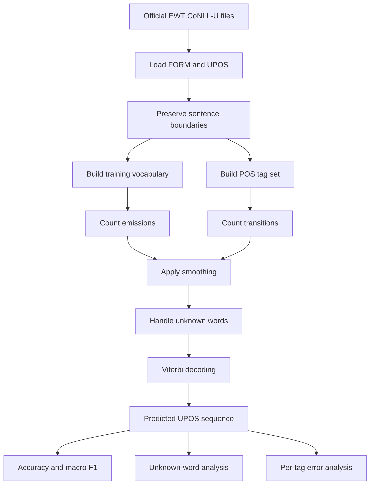
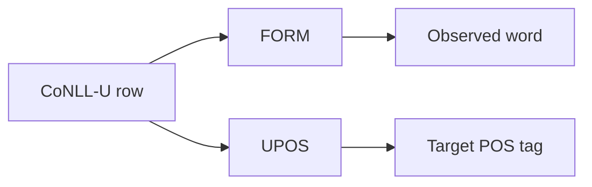
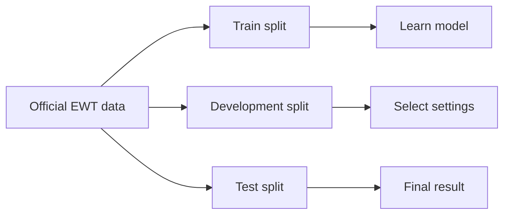
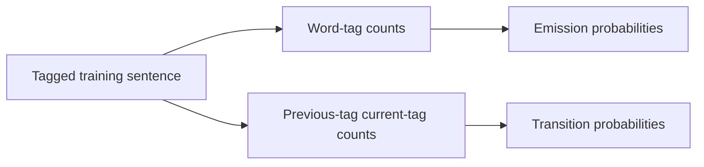
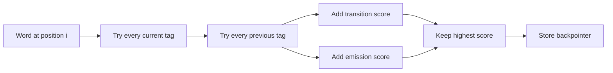
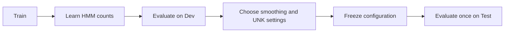
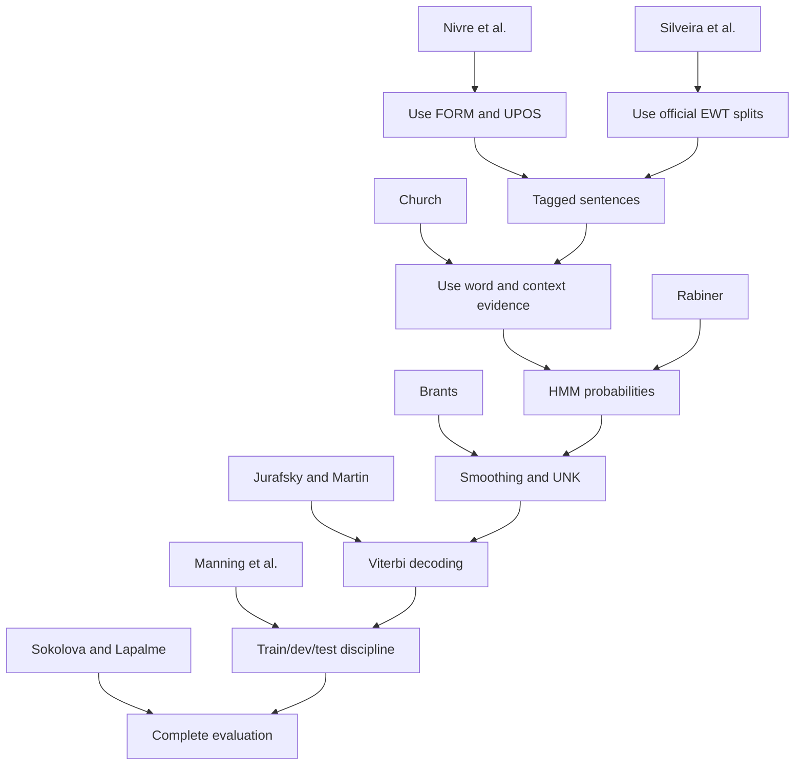

# Phase 1 Paper Implementation Guide

## Purpose

This guide explains how each Phase 1 reference contributes to the POS-tagging project.

The project objective is:

> Train and evaluate a smoothed Hidden Markov Model (HMM) for UPOS tagging on the official UD English EWT dataset.

The papers do not become separate programs. Each paper supports one part of the same project:


## How to Read This Guide

Each source section answers five questions:

1. What problem does the source address?
2. Which section of the source is relevant?
3. What idea does the project use?
4. What will the code do because of this idea?
5. What is outside the scope of Phase 1?

The formulas below use project notation. They explain the source ideas in a consistent form. They are not copied quotations.

## Project Pipeline

The final Phase 1 pipeline is:



---

# 1. Nivre et al. (2020)

## Source

**PDF:** `01_nivre_2020_universal_dependencies_v2.pdf`

**Paper:** *Universal Dependencies v2: An Evergrowing Multilingual Treebank Collection*

**Relevant sections:**

- Section 1, **Introduction**
- Section 2, **Annotation Scheme**
- Section 4, **Available Treebanks**
- Section 5, **Conclusion**

## What the Paper Does

Nivre et al. describes Universal Dependencies, or UD. UD provides a common annotation system for many languages.

The important annotation layers include:

- word form;
- lemma;
- universal part-of-speech tag;
- morphological features;
- dependency information.

The project uses only the word form and universal POS tag.

```text
CoNLL-U row:

ID  FORM  LEMMA  UPOS  XPOS  FEATS  HEAD  DEPREL  DEPS  MISC
1   dogs  dog    NOUN  NNS   ...     0     root    ...   ...
```

For this project:

```text
Input word: dogs
Target tag: NOUN
```

## What the Project Uses

The project uses:

- `FORM` as the observed word;
- `UPOS` as the target label;
- sentence boundaries;
- the official EWT train, development, and test splits.



## Code Responsibility

The dataset loader must:

1. Read the ten CoNLL-U columns.
2. Extract column 2, `FORM`.
3. Extract column 4, `UPOS`.
4. Keep tokens inside their original sentences.
5. Ignore comments.
6. Skip multiword-token rows.
7. Skip empty-node rows.

The result should have this structure:

```text
[
    [
        ("The", "DET"),
        ("dog", "NOUN"),
        ("runs", "VERB")
    ]
]
```

## Why This Matters

The HMM needs a sequence of observed words and a sequence of target tags. It does not need the dependency tree for Phase 1.

The project must not mix the ten CoNLL-U fields into the HMM without a clear reason. The Phase 1 model is a POS tagger, not a dependency parser.

## What Is Not Required

The project does not need to implement:

- dependency parsing;
- lemma prediction;
- morphological feature prediction;
- dependency relation prediction;
- enhanced dependency graphs.

Those fields may remain in the source data without entering the HMM.

---

# 2. Silveira et al. (2014)

## Source

**PDF:** `02_silveira_2014_english_web_treebank.pdf`

**Paper:** *A Gold Standard Dependency Corpus for English*

**Relevant sections:**

- Section 1, **Introduction**
- Section 2, **English Web Treebank**
- Section 3, **Dependency Annotation**
- Section 6, **Experiments**
- Section 7, **Conclusion**

## What the Paper Does

Silveira et al. describes the English Web Treebank, or EWT. The corpus contains English text collected from web sources and annotated for linguistic analysis.

The important project point is that the dataset is a prepared gold-standard resource. We must use the official data rather than create a new random split.

## What the Project Uses

The project uses these files:

```text
data/train.conllu
data/dev.conllu
data/test.conllu
```

Their roles are:

| Split | Purpose |
| --- | --- |
| Train | Learn the HMM probabilities. |
| Dev | Select smoothing and unknown-word settings. |
| Test | Produce the final result. |



## Code Responsibility

The project must:

1. Keep the three files separate.
2. Load each file through the same loader.
3. Preserve sentence boundaries.
4. Avoid random repartitioning.
5. Record the dataset revision.
6. Check expected sentence and token counts.

Current dataset checks are:

| Split | Sentences | Tokens |
| --- | ---: | ---: |
| Train | 12,544 | 204,578 |
| Dev | 2,001 | 25,148 |
| Test | 2,077 | 25,094 |

## Example of Correct Use

```text
Train:
    Used to build vocabulary and probability counts.

Development:
    Used to compare alpha values such as 0.01, 0.1, and 1.0.

Test:
    Used only after the best configuration is selected.
```

## Why This Matters

If test data is used to select the model, the final score becomes optimistic. The project would be measuring how well the model fits the test set rather than how well it generalizes.

## What Is Not Required

The HMM does not need to reproduce the full corpus creation process. It only needs to use the official published files correctly and document their source.

---

# 3. Church (1988)

## Source

**PDF:** `03_church_1988_stochastic_pos_tagger.pdf`

**Paper:** *A Stochastic Parts Program and Noun Phrase Parser for Unrestricted Text*

**Relevant location:** Opening discussion and method description, printed pages 136-137. The paper does not use clear numbered sections in the opening method discussion.

## What the Paper Does

Church explains that POS tagging is difficult because one word can have different tags in different contexts.

For example:

```text
He will table the motion.
The table is ready.
```

Here, `table` has different roles:

| Sentence | Tag of `table` |
| --- | --- |
| He will table the motion. | Verb-like usage |
| The table is ready. | Noun usage |

The word alone is not always enough. The surrounding tags and words provide useful evidence.

## What the Project Uses

The project combines two types of evidence.

### Word evidence

This asks:

> How likely is this word when the tag is known?

The formula is:

$$
P(word \mid tag)
$$

Example:

$$
P(run \mid NOUN)
$$

### Context evidence

This asks:

> How likely is the current tag after the previous tag?

The formula is:

$$
P(current\ tag \mid previous\ tag)
$$

Example:

$$
P(VERB \mid PRON)
$$

## Code Responsibility

Church leads to two HMM count tables:



The code must not build this incorrect mapping:

```text
run -> VERB
```

Instead, it must keep all observed evidence:

```text
run with NOUN count: 100
run with VERB count: 80
```

The decoder then uses the sentence context to choose the most likely tag.

## Why This Matters

This paper justifies the HMM design. It explains why a word-to-single-tag dictionary is not enough.

## What Is Not Required

Church's original tagset and corpus do not need to be copied. The project uses the UD UPOS tagset and the EWT dataset.

---

# 4. Rabiner (1989)

## Source

**PDF:** `04_rabiner_1989_hidden_markov_models.pdf`

**Paper:** *A Tutorial on Hidden Markov Models and Selected Applications in Speech Recognition*

**Relevant sections:**

- Section II, **Discrete Time Markov Chains**
- Section III, **Hidden Markov Models**
- Section III.A, **Elements of an HMM**
- Section III.B, **The Three Basic Problems of HMMs**
- Section III.C, **Solution to the Three Basic Problems of HMMs**

## What the Paper Does

Rabiner defines the general HMM. The HMM has hidden states and visible observations.

For this project:

| HMM concept | POS-tagging meaning |
| --- | --- |
| Hidden state | UPOS tag |
| Observation | Word |
| State sequence | POS-tag sequence |
| Transition | Movement from one tag to another |
| Emission | A tag producing a word |
| Initial state | Start of sentence |
| Final state | End of sentence |

## Example

Visible sentence:

```text
The dog runs
```

Hidden sequence to predict:

```text
DET NOUN VERB
```

The HMM estimates:

```text
P(DET after START)
P(NOUN after DET)
P(VERB after NOUN)
P(The after DET)
P(dog after NOUN)
P(runs after VERB)
```

## HMM Probability Model

Let the words be:

$$
W = (w_1, w_2, \ldots, w_T)
$$

Let the tags be:

$$
T = (t_1, t_2, \ldots, t_T)
$$

The model finds:

$$
\hat{T} = \underset{T}{\max}\ P(T \mid W)
$$

For decoding, the denominator is constant for the sentence. Therefore, the project maximizes the joint probability:

$$
\hat{T} = \underset{T}{\max}\ P(W,T)
$$

For a first-order HMM:

$$
P(W,T) =
P(t_1 \mid START)
\prod_{i=2}^{T}P(t_i \mid t_{i-1})
\prod_{i=1}^{T}P(w_i \mid t_i)
P(END \mid t_T)
$$

## Code Responsibility

Rabiner defines the model components. The project must implement:

- transition probabilities;
- emission probabilities;
- start-state probabilities;
- end-state probabilities;
- sequence decoding.

The project does not need Baum-Welch training. The training tags are already known in the EWT training data, so direct count estimation is sufficient.

## What Is Not Required

The project does not need to reproduce Rabiner's speech-recognition experiments. It only uses the HMM framework and the decoding method.

---

# 5. Brants (2000)

## Source

**PDF:** `05_brants_2000_tnt_pos_tagger.pdf`

**Paper:** *TnT: A Statistical Part-of-Speech Tagger*

**Relevant sections:**

- Section 2, **Architecture**
- Section 2.1, **The Underlying Model**
- Section 2.2, **Smoothing**
- Section 2.3, **Handling of Unknown Words**
- Section 2.4, **Capitalization**
- Section 3, **Evaluation**

## What the Paper Does

Brants shows how to build a practical statistical POS tagger. The paper is important because a basic HMM can fail if it ignores small implementation decisions.

The project uses the following ideas from Brants:

- sentence boundary tags;
- smoothing;
- unknown-word handling;
- careful evaluation.

## Section 2.1: Start and End States

A sentence should be represented as:

```text
START -> tag_1 -> tag_2 -> tag_3 -> END
```

For example:

```text
START -> DET -> NOUN -> VERB -> END
```

The start state helps the model learn which tags usually begin sentences. The end state helps it learn which tags usually finish sentences.

## Code Responsibility

The transition count must include:

```text
START -> first tag
previous tag -> current tag
last tag -> END
```

The code must not use only transitions inside the sentence.

## Section 2.2: Smoothing

Some transitions or emissions will not appear in the training corpus.

Without smoothing:

$$
P(unseen\ event)=0
$$

One zero value can make an entire candidate sequence impossible.

The first project baseline can use add-alpha smoothing:

$$
P_\alpha(t_i \mid t_{i-1}) =
\frac{C(t_{i-1},t_i)+\alpha}
{C(t_{i-1})+\alpha|Tags|}
$$

For emissions:

$$
P_\alpha(w \mid t) =
\frac{C(t,w)+\alpha}
{C(t)+\alpha|Vocabulary|}
$$

The development set selects the value of $\alpha$.

Brants uses interpolation of different tag-history sizes. That can be an optional experiment. It should not be added before the first-order model works.

## Section 2.3: Unknown Words

A test word may not appear in training.

Example:

```text
Training vocabulary: dog, cat, house
Test word: telescope
```

The model should map `telescope` to:

```text
UNK
```

Then it uses:

$$
P(UNK \mid tag)
$$

The project should first implement an `UNK` bucket. A suffix model can be tested later.

## Section 2.4: Capitalization

Capitalization can provide useful POS information. For example, a capitalized word may be a proper noun.

This is an optional Phase 1 extension. It must be tested on the development set and documented separately. Do not add it to the main baseline without measuring its effect.

## Code Responsibility

Brants turns the abstract HMM into a practical POS tagger. The code must record:

- smoothing method;
- smoothing value;
- unknown-word method;
- sentence boundary method;
- optional capitalization method;
- evaluation results.

---

# 6. Jurafsky and Martin

## Source

**PDF:** `06_jurafsky_martin_2026_sequence_labeling.pdf`

**Chapter:** Chapter 18, **Sequence Labeling for Parts of Speech and Named Entities**

**Relevant sections:**

- Section 18.1, **Mostly English Word Classes**
- Section 18.2, **Part-of-Speech Tagging**
- Section 18.4.1, **Markov Chains**
- Section 18.4.2, **The Hidden Markov Model**
- Section 18.4.3, **The components of an HMM tagger**
- Section 18.4.4, **HMM tagging as decoding**
- Section 18.4.5, **The Viterbi Algorithm**

## What the Source Does

This chapter connects general HMM theory to NLP sequence tagging.

It explains that:

- words are observations;
- POS tags are hidden states;
- tags have local sequence relationships;
- each word receives one output tag;
- Viterbi finds the best complete sequence.

## Markov Assumption

A first-order model uses this approximation:

$$
P(t_i \mid t_1, \ldots, t_{i-1})
\approx
P(t_i \mid t_{i-1})
$$

This makes the model manageable. It also limits the amount of context available to the HMM.

## HMM Components

The chapter connects the two main probabilities:

Transition:

$$
P(t_i \mid t_{i-1})
$$

Emission:

$$
P(w_i \mid t_i)
$$

The HMM combines them when scoring a tag sequence.

## Viterbi Algorithm

If the tag set contains $K$ tags and the sentence contains $T$ words, the number of possible sequences is:

$$
K^T
$$

Viterbi avoids testing every complete sequence independently.

The Viterbi table stores the best score for every position and possible tag:

$$
V_i(t) =
\text{best score for the first } i \text{ words ending with tag } t
$$

The recurrence is:

$$
V_i(t) =
\log P(w_i \mid t)
+
\max_u
\left[
V_{i-1}(u)+\log P(t \mid u)
\right]
$$

The code also stores a backpointer so it can reconstruct the best sequence.



## Code Responsibility

This source provides the clearest algorithmic bridge between the probability tables and the decoder.

The code must:

1. initialize the first word using `START`;
2. score every possible tag;
3. process the remaining words;
4. save the best previous tag;
5. add the `END` transition;
6. backtrack through the stored pointers.

---

# 7. Manning, Raghavan, and Schutze: Evaluation

## Source

**PDF:** `07_manning_raghavan_schutze_2008_evaluation.pdf`

**Relevant section:** Chapter 8, Section 8.1, **Information retrieval system evaluation**

## What the Source Does

This chapter explains why evaluation must use separate development and test data.

The project applies the same principle to POS tagging.

## Code Responsibility

Use the splits as follows:



Training data learns the model.

Development data selects the model settings.

Test data measures the final model.

## Example

Suppose the project tests three values:

```text
alpha = 0.01
alpha = 0.10
alpha = 1.00
```

The correct process is:

1. Train each version on the training split.
2. Measure each version on the development split.
3. Select the best development result.
4. Freeze the selected value.
5. Run the final evaluation on the test split.

The incorrect process is:

1. Try all values on the test set.
2. Select the best test result.
3. Report that result as final.

That process gives an unreliable score because the test set influenced the decision.

## What Is Not Required

The project does not need to use information-retrieval metrics such as ranked retrieval precision. The project uses the chapter's evaluation discipline, not its complete retrieval task.

---

# 8. Manning, Raghavan, and Schutze: Probability

## Source

**PDFs:**

- `08_manning_raghavan_schutze_2008_probability.pdf`
- `09_manning_raghavan_schutze_2008_language_models.pdf`

**Relevant sections:**

- Chapter 11, Sections 11.1-11.2, probability and uncertainty;
- Chapter 12, Section 12.1, language models.

## What the Source Does

These chapters provide supporting probability concepts:

- probability represents uncertainty;
- relative frequency can estimate probability;
- unseen events create zero-probability problems;
- products of many probabilities become numerically small;
- log probabilities turn multiplication into addition.

## Code Responsibility

The project uses relative frequency for the initial HMM estimates:

$$
P(t_i \mid t_{i-1}) =
\frac{count(t_{i-1},t_i)}{count(t_{i-1})}
$$

$$
P(w \mid t) =
\frac{count(t,w)}{count(t)}
$$

The project then applies smoothing and uses log probabilities during decoding.

## Log Probability Example

Instead of calculating:

$$
0.2 \times 0.1 \times 0.05
$$

calculate:

$$
\log(0.2)+\log(0.1)+\log(0.05)
$$

The result represents the same comparison while reducing numerical underflow.

## What Is Not Required

These chapters are not instructions to build an information-retrieval system. They support the probability explanation only.

---

# 9. Sokolova and Lapalme (2009)

## Source

**PDF:** `10_sokolova_lapalme_2009_classification_metrics.pdf`

**Paper:** *A Systematic Analysis of Performance Measures for Classification Tasks*

**Relevant sections:**

- Section 1, **Motivation**
- Section 2, **Overview of classification tasks**
- Section 4, **Invariance properties of measures**

## What the Paper Does

The paper explains that one evaluation measure may hide important weaknesses.

This matters because the EWT POS tags are not evenly distributed.

Common tags include:

```text
NOUN, PUNCT, VERB
```

Less frequent tags include:

```text
X, SYM, INTJ
```

A model can perform well on common tags and poorly on rare tags while still reporting good overall accuracy.

## Token Accuracy

$$
Accuracy =
\frac{correctly\ predicted\ tokens}
{all\ real\ tokens}
$$

This is the main overall result.

## Per-Tag Precision

For one POS tag $c$:

$$
Precision_c =
\frac{TP_c}{TP_c+FP_c}
$$

It asks:

> When the model predicts tag $c$, how often is it correct?

## Per-Tag Recall

$$
Recall_c =
\frac{TP_c}{TP_c+FN_c}
$$

It asks:

> How many real examples of tag $c$ did the model find?

## Per-Tag F1

$$
F1_c =
2 \cdot
\frac{Precision_c \cdot Recall_c}
{Precision_c+Recall_c}
$$

## Macro F1

For $K$ POS tags:

$$
F1_{macro} =
\frac{1}{K}\sum_{c=1}^{K}F1_c
$$

Macro F1 gives every POS tag equal importance.

## Confusion Matrix

A confusion matrix compares gold tags with predicted tags.

```text
                 Predicted
              NOUN  VERB  ADJ
Gold NOUN       80     5    10
Gold VERB        7    90     3
Gold ADJ         8     4    60
```

This can reveal patterns such as:

- `NOUN` predicted as `PROPN`;
- `ADJ` predicted as `NOUN`;
- `AUX` predicted as `VERB`;
- `ADP` predicted as `ADV`.

## Unknown-Word Accuracy

This is a project-specific diagnostic.

Let $U$ be the positions whose original words do not occur in training:

$$
UnknownAccuracy =
\frac{correct\ predictions\ on\ U}
{|U|}
$$

The original word must be used to decide whether the token is unknown. Do not decide this after replacing the word with `UNK`.

## Code Responsibility

The evaluation code must return:

- token accuracy;
- macro F1;
- per-tag precision;
- per-tag recall;
- per-tag F1;
- confusion matrix;
- unknown-word accuracy.

---

# 10. How the Sources Work Together



The sources have different responsibilities:

| Source | Responsibility |
| --- | --- |
| Nivre et al. | Defines the data annotation and UPOS labels. |
| Silveira et al. | Defines the English Web Treebank data source and split usage. |
| Church | Explains why word and context evidence are both needed. |
| Rabiner | Defines the HMM model. |
| Brants | Adds practical POS-tagging decisions. |
| Jurafsky and Martin | Explains HMM POS tagging and Viterbi clearly. |
| Manning et al., Chapter 8 | Defines development/test evaluation discipline. |
| Manning et al., Chapters 11-12 | Supports probability and log-probability reasoning. |
| Sokolova and Lapalme | Defines the need for multiple evaluation measures. |

# 11. Final Code Responsibilities

The papers lead to these implementation modules:

```text
src/
├── dataset_loader.py
├── dataset_registry.py
├── preprocessing.py
├── hmm_model.py
└── evaluation.py
```

## `dataset_loader.py`

Uses Nivre and Silveira.

Responsibilities:

- load the official CoNLL-U files;
- extract `FORM` and `UPOS`;
- preserve sentences;
- skip comments and non-word rows.

## `dataset_registry.py`

Uses Silveira.

Responsibilities:

- define the official train, development, and test paths;
- check that all files exist;
- prevent accidental use of different files.

## `preprocessing.py`

Uses Nivre, Church, and Brants.

Responsibilities:

- build the training vocabulary;
- build the UPOS tag mapping;
- add `<UNK>`;
- normalize unknown words;
- prepare sentence-level data.

## `hmm_model.py`

Uses Rabiner, Brants, Church, and Jurafsky and Martin.

Responsibilities:

- count transitions;
- count emissions;
- add start and end states;
- smooth probabilities;
- calculate log probabilities;
- decode with Viterbi.

## `evaluation.py`

Uses Manning and Sokolova and Lapalme.

Responsibilities:

- evaluate only after configuration is selected;
- calculate accuracy;
- calculate macro F1;
- calculate unknown-word accuracy;
- produce per-tag results;
- produce a confusion matrix.

# 12. What the Project Must Not Do

Do not:

- rebuild the official EWT splits;
- use test data to select smoothing;
- create a word-to-one-tag dictionary;
- ignore sentence boundaries;
- use zero probabilities without smoothing;
- let unknown words crash the decoder;
- report accuracy without macro F1;
- evaluate padding or special symbols as real tokens;
- claim that Phase 1 implements the BiLSTM;
- copy code from a paper without understanding its assumptions.

# 13. Final Understanding

The project uses the papers in this order:

1. Nivre defines the labels.
2. Silveira defines the dataset source and split discipline.
3. Church explains the POS ambiguity problem.
4. Rabiner defines the HMM.
5. Brants makes the HMM practical.
6. Jurafsky and Martin explain the POS-tagging and Viterbi workflow.
7. Manning explains how to select and test the model fairly.
8. Sokolova and Lapalme explain how to measure the result.

The final Phase 1 system is therefore:

```text
Official EWT data
    -> FORM and UPOS sequences
    -> training counts
    -> smoothed HMM
    -> unknown-word handling
    -> Viterbi decoding
    -> final metrics and error analysis
```

This is the complete role of the Phase 1 literature in the project.
