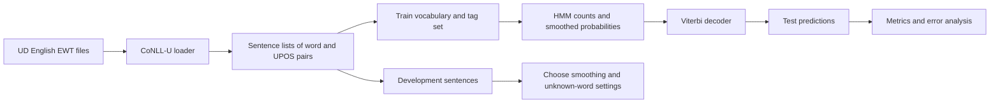
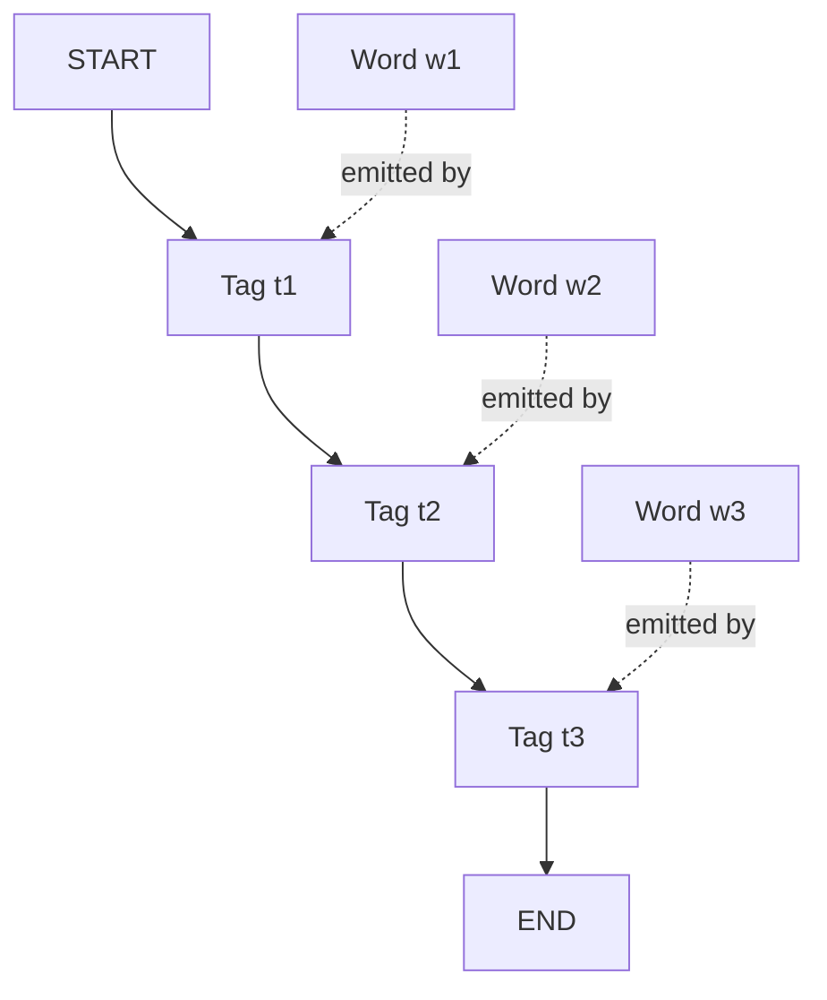

# Phase 1 Literature Guide: HMM POS Tagging

## Purpose

This document converts the Phase 1 literature into an implementation guide for the project:

> Build and evaluate a smoothed Hidden Markov Model (HMM) for Universal Dependencies English Web Treebank (UD English EWT) part-of-speech tagging.

Phase 1 is the machine learning phase. The BiLSTM belongs to Phase 2. Do not use the Phase 2 papers to expand the Phase 1 implementation.

The Phase 1 model must:

- preserve sentence boundaries;
- use the official train, development, and test splits;
- estimate transition and emission probabilities from training data;
- handle unseen words;
- use start and end states;
- decode with the Viterbi algorithm;
- report token accuracy, macro F1-score, unknown-word accuracy, and per-tag errors.

## Recommended Reading Order

| Order | Local PDF | Main use in this project |
| --- | --- | --- |
| 1 | `Nivre, J. et al. (2020)..pdf` | Understand UD v2, UPOS, and treebank standards. |
| 2 | `Silveira, M. et al. (2014)..pdf` | Understand the English Web Treebank data source. |
| 3 | `Church (1988), A Stochastic Parts Program and Noun Phrase Parser for Unrestricted Text.pdf` | Understand why local word and tag context can solve POS ambiguity. |
| 4 | `rabiner.pdf` | Learn the HMM probability model and Viterbi decoding. |
| 5 | `brants.pdf` | Learn practical POS-tagging choices: smoothing, sentence markers, and unknown words. |
| 6 | `Jurafsky, D., & Martin, J. H._18.pdf` | Review statistical sequence models and POS tagging in a modern NLP text. |
| 7 | `Manning, C. D., Raghavan, P., & Schutze...` | Review probability, language models, and evaluation concepts. |
| 8 | `ASystematicAnalysisofPerformanceMeasuresforClassificationTasks.pdf` | Justify accuracy, precision, recall, F1, and macro averaging. |

The most important reading set is Nivre, Silveira, Church, Rabiner, Brants, and Sokolova and Lapalme.

## How to Use the Source Notes

Each source note identifies the local PDF, the section title, and the printed page when the PDF provides one. The section names use the paper's own numbering. The formulas in this guide are rewritten in the notation used by this project; they are not presented as verbatim quotations.

| Topic | Source location | What to take from it |
| --- | --- | --- |
| UPOS labels and annotation layers | `Nivre, J. et al. (2020)..pdf`, Section 2, **Annotation Scheme**, pp. 4035-4037 | Use the UD annotation model and universal POS tags. |
| Available treebanks and split context | `Nivre, J. et al. (2020)..pdf`, Section 4, **Available Treebanks**, pp. 4040-4042 | Treat the published treebank splits as fixed evaluation data. |
| English Web Treebank | `Silveira, M. et al. (2014)..pdf`, Section 2, **English Web Treebank**, pp. 2898-2899 | Describe the source, web genres, and corpus construction. |
| POS ambiguity and local context | `Church (1988), A Stochastic Parts Program and Noun Phrase Parser for Unrestricted Text.pdf`, opening discussion and method description, printed pp. 136-137 | Motivate lexical and contextual probabilities. |
| HMM definition | `rabiner.pdf`, Section III, **Hidden Markov Models**, especially Sections III.A-III.C | Define states, observations, transition probabilities, emissions, and the three HMM problems. |
| Viterbi decoding | `rabiner.pdf`, Section III.C, **Solution to the Three Basic Problems of HMMs**, and `Jurafsky, D., & Martin, J. H._18.pdf`, Section 18.4.5, **The Viterbi Algorithm** | Use dynamic programming instead of enumerating all tag sequences. |
| HMM POS tagging | `Jurafsky, D., & Martin, J. H._18.pdf`, Sections 18.4.1-18.4.6 | Connect the general HMM to word observations and POS-tag states. |
| Smoothing | `brants.pdf`, Section 2.2, **Smoothing**, printed pp. 225-226 | Avoid zero-probability paths and record the smoothing method. |
| Unknown words | `brants.pdf`, Section 2.3, **Handling of Unknown Words**, printed pp. 226-227 | Use an `UNK` baseline and consider suffix evidence as an extension. |
| Start and end states | `brants.pdf`, Section 2.1, **The Underlying Model**, printed pp. 224-225 | Include sentence boundary tags in transition scoring. |
| Evaluation measures | `ASystematicAnalysisofPerformanceMeasuresforClassificationTasks.pdf`, Sections 1-2, printed pp. 427-429, and Section 4, **Invariance properties of measures**, pp. 430-436 | Explain multi-class evaluation, confusion matrices, and metric limitations. |

### Evidence versus project decisions

- **Source-backed:** HMMs combine transition and observation probabilities; local context helps POS tagging; smoothing and unknown-word handling matter; evaluation must consider class distribution.
- **Project notation:** $P(w \mid t)$, $P(t_i \mid t_{i-1})$, and the Viterbi table names used below.
- **Project decision:** use a first-order HMM with add-alpha smoothing and an `UNK` bucket as the first baseline. Brants uses a second-order model and richer unknown-word handling, but the smaller baseline is easier to test and explain.
- **Not required in Phase 1:** CRFs, neural models, character embeddings, and BiLSTM training. Those belong to Phase 2.

## 1. Project Context

The current EDA reports these values:

| Split | Sentences | Tokens |
| --- | ---: | ---: |
| Train | 12,544 | 204,578 |
| Dev | 2,001 | 25,148 |
| Test | 2,077 | 25,094 |

The training vocabulary contains 19,674 word types. The development and test sets contain unseen word types, so a model that only stores probabilities for known training words will fail on part of the evaluation data.

The project uses the UPOS tag field from CoNLL-U. The EDA shows 17 UPOS classes. The tag set must come from the official annotations. Do not invent a new tag mapping and do not merge tags without a documented reason.

The correct data flow is:



Use the test set only after model decisions are complete.

## 2. Literature Synthesis

### 2.1 Universal Dependencies: Nivre et al. (2020)

**Source anchor:** `Nivre, J. et al. (2020)..pdf`, Section 2, **Annotation Scheme**, pp. 4035-4037; Section 4, **Available Treebanks**, pp. 4040-4042.

The UD v2 paper explains a common annotation framework for many languages. For this project, the important points are:

- words are represented with standardized annotations;
- UPOS provides a universal part-of-speech inventory;
- the treebank has published data splits and annotation guidelines;
- tokenization and annotation decisions affect model results.

**Project decision:** use `FORM` as the observed word and `UPOS` as the target tag. Keep the official sentence boundaries. The loader already ignores multiword-token and empty-node rows. This is correct for a token-level POS tagger, but the choice must be stated in the report.

### 2.2 English Web Treebank: Silveira et al. (2014)

**Source anchor:** `Silveira, M. et al. (2014)..pdf`, Section 2, **English Web Treebank**, pp. 2898-2899; Section 6, **Experiments**, pp. 2900-2901.

The EWT paper describes a gold-standard English web corpus. The data comes from different web genres, so the language is not identical to edited news text. This matters because:

- vocabulary varies by genre;
- unknown words are expected;
- punctuation and informal forms may affect tagging;
- results should be reported on the official split rather than on a custom sample.

**Project decision:** describe the corpus source and its genre variation. Do not claim that the model represents all English. It represents the supplied UD English EWT test distribution.

### 2.3 Statistical POS Tagging: Church (1988)

**Source anchor:** `Church (1988), A Stochastic Parts Program and Noun Phrase Parser for Unrestricted Text.pdf`, opening discussion and method description, printed pp. 136-137. This PDF does not use numbered section headings in the opening pages, so the paragraph location is the reliable locator.

Church presents a statistical POS tagger that chooses the most likely tag sequence by combining lexical evidence and contextual evidence. The central lesson is that a word can have different tags in different contexts. For example, a word such as `table` can be a noun or a verb.

The paper uses a local n-gram approximation. It also shows an important practical result: a simple statistical model can perform well when the training data and local context are used correctly.

**Project lesson:** the HMM must not be a word-to-one-tag dictionary. It must combine:

- how likely a word is under a tag; and
- how likely a tag is after the previous tag.

The paper also warns that a short-context model cannot represent every long-distance dependency. This is a limitation to mention in the Phase 1 report, not a reason to hide the model's errors.

### 2.4 HMM Theory: Rabiner (1989)

**Source anchor:** `rabiner.pdf`, Section III, **Hidden Markov Models**, especially Section III.A, **Elements of an HMM**, Section III.B, **The Three Basic Problems of HMMs**, and Section III.C, **Solution to the Three Basic Problems of HMMs**.

Rabiner presents the general HMM framework. The model contains:

- hidden states;
- observations;
- initial-state probabilities;
- state-transition probabilities;
- observation or emission probabilities.

For this project:

- the hidden states are UPOS tags;
- the observations are words;
- the initial state is a sentence-start marker;
- the final state is a sentence-end marker;
- the output is the most likely tag sequence.

The HMM does not directly observe the correct tags at prediction time. It uses the word sequence and the learned probability tables to infer them.



The horizontal edges represent transition probabilities. The dotted edges represent emission probabilities.

### 2.5 Practical POS Tagging: Brants (2000)

**Source anchor:** `brants.pdf`, Section 2, **Architecture**, printed pp. 224-227; Section 2.1, **The Underlying Model**; Section 2.2, **Smoothing**; Section 2.3, **Handling of Unknown Words**; and Section 3, **Evaluation**, pp. 227-231.

Brants describes TnT, a statistical POS tagger based on a Markov model. The paper is especially useful because it discusses details that are easy to omit in a basic implementation:

- sentence start and end markers;
- sparse counts;
- interpolation of lower- and higher-order probabilities;
- unknown-word handling;
- efficient decoding;
- the difference between a theoretical model and a working tagger.

TnT uses a second-order Markov model. Its transition probability depends on two previous tags. The project can begin with a first-order HMM because it is easier to test and explain. A second-order extension can be an optional experiment if the first model is stable.

**Important project lesson:** the small engineering decisions can affect the result as much as the name of the model. Record the smoothing method, unknown-word method, sentence markers, and decoding convention.

### 2.6 Probability and Language Models: Manning, Raghavan, and Schutze

**Source anchor:** `Manning, C. D., Raghavan, P., & Schütze, H._11prob.pdf`, Chapter 11, Sections 11.1-11.2, for probability and uncertainty; `Manning, C. D., Raghavan, P., & Schütze, H._12lmodel.pdf`, Chapter 12, Section 12.1, **Language models**, for generative probability intuition. These chapters support the explanation but are not POS-tagging papers.

The local chapters provide supporting probability concepts:

- probabilities express uncertainty about observations;
- relative frequency is a useful starting estimate;
- unseen events create zero-probability problems;
- a model must balance observed counts with generalization;
- log probabilities make products numerically stable.

The language-model chapter is written for information retrieval, not POS tagging. Use it for probability intuition only. Do not describe the HMM as an information-retrieval model.

### 2.7 Evaluation: Sokolova and Lapalme (2009)

**Source anchor:** `ASystematicAnalysisofPerformanceMeasuresforClassificationTasks.pdf`, Section 2, **Overview of classification tasks**, printed pp. 428-429; Section 4, **Invariance properties of measures**, printed pp. 430-436. The paper's definitions of precision, recall, and F-score appear in the discussion around printed pp. 428-429.

Sokolova and Lapalme analyze classification measures through confusion matrices and class distributions. This is relevant because POS tagging is a multi-class classification problem with imbalanced tag frequencies.

Accuracy alone can hide weak performance on rare tags. Macro F1 gives every tag equal weight, so common tags do not fully dominate the score.

**Project decision:** report token accuracy and macro F1 together. Also report unknown-word accuracy and per-tag results.

## 2.8 What Each PDF Contributes

Use the PDFs for different jobs. This prevents the literature review from becoming a list of unrelated summaries.

### Nivre et al.: define the label system

Read Section 2, **Annotation Scheme**, to understand the annotation layers and the universal POS tag field. Read Section 4, **Available Treebanks**, to understand the UD resource collection. This source supports the statement that the target labels are standardized UD annotations. It does not define the HMM.

### Silveira et al.: define the data source

Read Section 2, **English Web Treebank**, for the corpus source and web-domain composition. Read Section 3, **Dependency Annotation**, only for annotation context that affects how the corpus was prepared. This source supports the dataset description. It does not justify a smoothing formula.

### Church: motivate a statistical tagger

Read the opening examples and the method description on printed pages 136-137. The paper's `table` examples show why a word needs context. The method combines lexical probabilities with contextual probabilities and uses dynamic programming. This source supports the motivation for the HMM and the error-analysis discussion about lexical ambiguity.

### Rabiner: define the HMM and dynamic programming problem

Read Section III.A, **Elements of an HMM**, for model components; Section III.B, **The Three Basic Problems of HMMs**, for likelihood, decoding, and learning; and Section III.C, **Solution to the Three Basic Problems of HMMs**, for the forward, Viterbi, and Baum-Welch solution ideas. For this project, use the decoding problem and the Viterbi solution. Do not claim that Phase 1 trains an HMM with Baum-Welch; the POS tags are observed in the training corpus, so the transition and emission counts can be estimated directly.

### Brants: turn the theory into a POS tagger

Read Section 2.1, **The Underlying Model**, for tag states, word outputs, and boundary markers. Read Section 2.2, **Smoothing**, for sparse n-gram counts and interpolation. Read Section 2.3, **Handling of Unknown Words**, for suffix-based unknown-word probabilities. Read Section 3, **Evaluation**, to see how a statistical POS tagger is measured on held-out corpora.

### Jurafsky and Martin: connect the ideas in one sequence-labeling chapter

Read Chapter 18, **Sequence Labeling for Parts of Speech and Named Entities**. The most useful sections are 18.1, **Mostly English Word Classes**; 18.2, **Part-of-Speech Tagging**; 18.4.1, **Markov Chains**; 18.4.2, **The Hidden Markov Model**; 18.4.3, **The components of an HMM tagger**; 18.4.4, **HMM tagging as decoding**; and 18.4.5, **The Viterbi Algorithm**. This is the best single reference for connecting UPOS tagging, HMM notation, and Viterbi decoding.

### Manning, Raghavan, and Schutze: support probability and evaluation discipline

Read Chapter 8, Section 8.1, **Information retrieval system evaluation**, for the need for a representative test collection and gold-standard labels. Read the discussion of development test collections in Section 8.1, printed p. 152, for the rule that parameters must be selected on development data and then evaluated on test data. Read Chapter 11, Sections 11.1-11.2, for probability under uncertainty. Read Chapter 12, Section 12.1, for language-model probability intuition. These are supporting chapters, not direct POS-tagging sources.

### Sokolova and Lapalme: select metrics for imbalanced classes

Read Section 1, **Motivation**, for the reason that evaluation measures must match the task. Read Section 2, **Overview of classification tasks**, for multi-class classification and the precision, recall, and F-score definitions. Read Section 4, **Invariance properties of measures**, for the warning that a metric can hide some changes in a confusion matrix. This supports reporting macro F1 and per-tag results in addition to accuracy.

## 3. HMM Formulation for This Project

**Source anchor:** `Jurafsky, D., & Martin, J. H._18.pdf`, Sections 18.4.2, **The Hidden Markov Model**, and 18.4.3, **The components of an HMM tagger**; `rabiner.pdf`, Section III.A, **Elements of an HMM**. The notation below adapts those definitions to UD words and UPOS tags.

Let a sentence contain observed words:

$$
W = (w_1, w_2, \ldots, w_T)
$$

Let the hidden UPOS tags be:

$$
T = (t_1, t_2, \ldots, t_T)
$$

The decoder must find:

$$
\hat{T} = \underset{T}{\operatorname{argmax}}\ P(T \mid W)
$$

Using Bayes' rule, the denominator $P(W)$ is constant for a given sentence. Therefore, maximize the joint probability:

$$
\hat{T} = \underset{T}{\operatorname{argmax}}\ P(W, T)
$$

For a first-order HMM with start state $\langle s \rangle$ and end state $\langle /s \rangle$:

$$
P(W,T) = P(t_1 \mid \langle s \rangle)
\prod_{i=2}^{T} P(t_i \mid t_{i-1})
\prod_{i=1}^{T} P(w_i \mid t_i)
P(\langle /s \rangle \mid t_T)
$$

The model has two learned tables.

### 3.1 Transition probability

**Source anchor:** `Jurafsky, D., & Martin, J. H._18.pdf`, Section 18.4.3, **The components of an HMM tagger**; `brants.pdf`, Section 2.1, **The Underlying Model**, equations (2)-(4), printed pp. 224-225.

The maximum-likelihood transition estimate is:

$$
P(t_i \mid t_{i-1}) =
\frac{C(t_{i-1}, t_i)}{C(t_{i-1})}
$$

Here, $C(a,b)$ is the number of times tag $b$ follows tag $a$ in the training data. Include the start and end markers in these counts.

### 3.2 Emission probability

**Source anchor:** `Jurafsky, D., & Martin, J. H._18.pdf`, Section 18.4.3, **The components of an HMM tagger**; `brants.pdf`, Section 2.1, **The Underlying Model**, equation (5), printed p. 225.

The maximum-likelihood emission estimate is:

$$
P(w \mid t) = \frac{C(t,w)}{C(t)}
$$

Here, $C(t,w)$ is the number of times word $w$ has tag $t$ and $C(t)$ is the number of tokens with tag $t$.

A word can occur with more than one tag. The EDA already shows this ambiguity. Do not replace the counts with one selected tag per word.

### 3.3 Add-alpha smoothing

**Source anchor:** `brants.pdf`, Section 2.2, **Smoothing**, printed pp. 225-226. Brants uses interpolated n-gram probabilities rather than the exact add-alpha equations below. Add-alpha is the project baseline because it is transparent, easy to test, and directly prevents zero probabilities.

A simple baseline uses add-alpha smoothing:

$$
P_\alpha(t_i \mid t_{i-1}) =
\frac{C(t_{i-1},t_i)+\alpha}
{C(t_{i-1})+\alpha |\mathcal{T}|}
$$

$$
P_\alpha(w \mid t) =
\frac{C(t,w)+\alpha}
{C(t)+\alpha |\mathcal{V}|}
$$

where:

- $\alpha > 0$ is the smoothing value;
- $\mathcal{T}$ is the tag set;
- $\mathcal{V}$ is the model vocabulary.

For unknown words, do not use the entire test vocabulary when estimating training probabilities. Map words outside the training vocabulary to `UNK`, then estimate the `UNK` emission count from training data.

A practical alternative is a class-conditional unknown-word model. Brants uses suffix information. For this project, the recommended order is:

1. `UNK` bucket baseline;
2. suffix-based unknown-word experiment if time permits;
3. compare both on the development set.

### 3.4 Linear interpolation

**Source anchor:** `brants.pdf`, Section 2.2, **Smoothing**, printed pp. 225-226, especially the interpolation equation and deleted-interpolation discussion.

Brants uses interpolation to combine unigram, bigram, and trigram tag estimates:

$$
P(t_i \mid t_{i-2},t_{i-1}) =
\lambda_1 P(t_i)
+ \lambda_2 P(t_i \mid t_{i-1})
+ \lambda_3 P(t_i \mid t_{i-2},t_{i-1})
$$

with:

$$
\lambda_1 + \lambda_2 + \lambda_3 = 1
$$

This is relevant if a second-order extension is implemented. It is not required for the first working HMM. Do not add a complex interpolation method before the first-order model has tests and a baseline result.

## 4. Viterbi Decoding

**Source anchor:** `Jurafsky, D., & Martin, J. H._18.pdf`, Sections 18.4.4, **HMM tagging as decoding**, and 18.4.5, **The Viterbi Algorithm**; `rabiner.pdf`, Section III.C, **Solution to the Three Basic Problems of HMMs**. The recurrence below is the project-specific first-order form.

Directly checking every possible tag sequence is expensive. If there are $K$ tags and $T$ words, there are $K^T$ possible sequences. Viterbi decoding reuses partial results.

Work in log space. This changes products into sums and avoids numerical underflow:

$$
\log P(a b) = \log P(a) + \log P(b)
$$

Define:

$$
V_i(t) = \text{best log score for the first } i \text{ words ending in tag } t
$$

Initialization:

$$
V_1(t) =
\log P(t \mid \langle s \rangle)
+ \log P(w_1 \mid t)
$$

Recurrence:

$$
V_i(t) =
\log P(w_i \mid t)
+ \max_{u \in \mathcal{T}}
\left[V_{i-1}(u) + \log P(t \mid u)\right]
$$

Store the tag that gives the maximum value:

$$
B_i(t) = \underset{u \in \mathcal{T}}{\operatorname{argmax}}
\left[V_{i-1}(u) + \log P(t \mid u)\right]
$$

Termination:

$$
\hat{t}_T = \underset{t \in \mathcal{T}}{\operatorname{argmax}}
\left[V_T(t) + \log P(\langle /s \rangle \mid t)\right]
$$

Backtrack through $B_i(t)$ to recover the complete tag sequence.


### Decoder invariants

The implementation should satisfy these checks:

- output length equals input sentence length;
- every output tag belongs to the official tag set;
- an empty sentence is rejected or handled by a documented rule;
- every backpointer refers to a valid previous tag;
- the decoder returns a result when an unknown word occurs;
- the start and end transitions are included exactly once.

## 5. Unknown-Word Handling

**Source anchor:** `brants.pdf`, Section 2.3, **Handling of Unknown Words**, printed pp. 226-227. Brants describes suffix-based estimates for unknown words. The `UNK` bucket is the simpler Phase 1 baseline selected for this project.

The EDA shows meaningful unknown-word rates in development and test. This is a central Phase 1 problem, not a minor edge case.

Recommended baseline:

1. Build `vocabulary` from training words only.
2. Replace every training word with `UNK` only when it is reserved for the unknown bucket, or create the unknown count through a documented training procedure.
3. At development and test time, replace every word not in `vocabulary` with `UNK`.
4. Estimate $P(UNK \mid t)$ from training data.
5. Report accuracy on tokens whose original words were unseen in training.

Use the original word to define the unknown-word evaluation subset. Do not define unknown status after replacing the word with `UNK`.

A stronger but still interpretable extension uses word suffixes. For an unknown word such as `modernized`, collect training words with related endings and estimate a tag distribution. This can help with morphological patterns, but it adds assumptions and should be reported as a separate experiment.

## 6. Evaluation Plan

**Source anchor:** `ASystematicAnalysisofPerformanceMeasuresforClassificationTasks.pdf`, Section 2, **Overview of classification tasks**, printed pp. 428-429, and Section 4, **Invariance properties of measures**, printed pp. 430-436. The project applies these multi-class metric ideas to token-level UPOS predictions.

### 6.1 Token accuracy

**Source note:** Accuracy is a standard measure discussed in the paper's motivation and metric overview. The equation below is the direct token-level adaptation for this project.

For all tokens in an evaluation split:

$$
\operatorname{Accuracy} =
\frac{\#\text{correctly predicted tags}}
{\#\text{tokens}}
$$

Accuracy is easy to understand, but frequent tags can dominate it.

### 6.2 Per-tag precision, recall, and F1

**Source anchor:** `ASystematicAnalysisofPerformanceMeasuresforClassificationTasks.pdf`, Section 2, printed pp. 428-429, where precision, recall, and F-score are defined from classification outcomes. The subscript $c$ adapts the definitions to one UPOS class at a time.

For a tag $c$:

$$
\operatorname{Precision}_c =
\frac{TP_c}{TP_c + FP_c}
$$

$$
\operatorname{Recall}_c =
\frac{TP_c}{TP_c + FN_c}
$$

$$
F1_c =
2 \cdot
\frac{\operatorname{Precision}_c \cdot \operatorname{Recall}_c}
{\operatorname{Precision}_c + \operatorname{Recall}_c}
$$

If both precision and recall are zero, define $F1_c = 0$ in the metric implementation.

### 6.3 Macro F1

**Source note:** The paper discusses multi-class evaluation and class distribution in Section 2, printed pp. 428-429. Macro averaging is the project choice that gives each of the 17 UPOS classes equal weight; report the per-tag values with it.

For $K$ UPOS classes:

$$
F1_{macro} = \frac{1}{K}\sum_{c=1}^{K} F1_c
$$

Macro F1 gives each tag equal weight. This is important for rare classes such as `X`, `SYM`, or `INTJ`.

### 6.4 Unknown-word accuracy

**Source note:** This metric is a project-specific diagnostic derived from the project's unknown-word analysis. It is not a standard metric defined by the cited evaluation paper. The definition makes the model's performance on unseen vocabulary visible.

Let $U$ be the set of evaluation token positions whose original words do not occur in the training vocabulary:

$$
\operatorname{UnknownAccuracy} =
\frac{\#\{i \in U : \hat{t}_i = t_i\}}
{|U|}
$$

Report the number of unknown tokens as well as the accuracy. A percentage without the sample count is incomplete.

### 6.5 Confusion matrix

A confusion matrix records the true tag on one axis and the predicted tag on the other. Use it to identify systematic errors, such as:

- `NOUN` predicted as `PROPN`;
- `ADJ` predicted as `NOUN`;
- `AUX` predicted as `VERB`;
- `ADP` predicted as `ADV`;
- punctuation assigned to a content tag.

The exact error categories must come from the model output. Do not select examples only because they support the expected result.

## 7. Experimental Design

**Source anchor for the split rule:** `Manning, C. D., Raghavan, P., & Schütze, H._08eval.pdf`, Chapter 8, Section 8.1, **Information retrieval system evaluation**, printed p. 152. The chapter states that parameters should be tuned on a development collection and then tested on a separate collection. The project applies the same principle to smoothing and unknown-word settings.

### Required experiment sequence

| Experiment | Purpose | Split |
| --- | --- | --- |
| HMM with unsmoothed counts | Demonstrate the zero-probability problem. | Dev only; diagnostic. |
| HMM with add-alpha smoothing | Establish the required baseline. | Dev, then test once finalized. |
| HMM with `UNK` handling | Measure the effect of unseen-word support. | Dev, then test once finalized. |
| Optional suffix unknown-word model | Test a Brants-inspired improvement. | Dev, then test once finalized. |
| Optional second-order HMM | Test additional tag context. | Dev, then test once finalized. |

Choose smoothing values on the development set. Do not tune on test results.

Keep a results table with:

- model name;
- transition order;
- smoothing method and value;
- unknown-word method;
- token accuracy;
- macro F1;
- unknown-word accuracy;
- runtime, if measured;
- notes about failure cases.

A strong result is not only a high score. It is a result that can be reproduced and explained.

## 8. Error Analysis

After finalizing the model, produce a small, honest error analysis.

For each selected error, record:

| Field | Meaning |
| --- | --- |
| Sentence | The original sentence or a short context window. |
| Word | The token being analyzed. |
| Gold tag | The official UPOS tag. |
| Predicted tag | The HMM output. |
| Known or unknown | Whether the word occurred in training. |
| Likely cause | Lexical ambiguity, sparse transition, unknown morphology, or another supported cause. |

Group errors by:

- true tag;
- predicted tag;
- known versus unknown word;
- word frequency;
- sentence context.

Do not claim that an error is caused by long-range syntax unless the example supports that claim. The HMM limitation is that it uses a restricted Markov context. State this as a model limitation and connect it to the evidence.

## 9. What to Implement in the Repository

A clean Phase 1 structure can use these modules:

```text
src/
├── dataset_loader.py
├── hmm_model.py
├── preprocessing.py
└── evaluation.py

experiments/
└── phase1_hmm.py

notebooks/
├── eda.ipynb
└── phase1_hmm_analysis.ipynb

tests/
├── test_dataset_loader.py
├── test_imports.py
├── test_preprocessing.py
├── test_hmm_model.py
└── test_evaluation.py

reports/
└── phase1_results.md
```

This is a recommended structure. Keep the implementation small. A single tested HMM module is better than several incomplete abstractions.

### Minimum public interfaces

The exact names may vary, but the model should support:

```python
model.fit(train_sentences)
predicted_tags = model.predict(sentence_words)
```

The preprocessing code should make the vocabulary and tag set explicit. The evaluation code should accept gold and predicted tag sequences and return a structured result.

## 10. Reproducibility and Quality Rules

Apply these rules to the Phase 1 work:

- Use the locked project environment.
- Record the Python and package versions.
- Keep the official dataset revision.
- Build vocabulary and probability tables from training data only.
- Use development data for model choices.
- Use test data for final reporting only.
- Keep sentence boundaries in all model inputs and outputs.
- Use log probabilities in Viterbi decoding.
- Use deterministic ordering for tags and vocabulary where possible.
- Add tests before changing the decoding logic.
- Report zero-division behavior for metrics.
- Keep raw predictions for later error analysis.
- Do not overwrite the EDA results with model results.

## 11. Phase 1 Deliverables

The Phase 1 submission should contain:

1. A literature review using the papers in this folder.
2. A description of UD English EWT and the official splits.
3. The existing EDA findings.
4. A tested HMM implementation.
5. A clear explanation of smoothing and unknown-word handling.
6. Viterbi decoding with start and end states.
7. Development-set experiment results.
8. Final test-set token accuracy.
9. Final test-set macro F1-score.
10. Unknown-word accuracy.
11. Per-tag metrics and error analysis.
12. Reproducible commands and environment details.
13. A project report, presentation, and individual viva preparation.

## 12. Final Phase 1 Checklist

Before calling Phase 1 complete, confirm:

- [ ] The literature review explains HMM POS tagging.
- [ ] The dataset source and UPOS labels are documented.
- [ ] The train, development, and test split roles are documented.
- [ ] The vocabulary uses training data only.
- [ ] Unknown words map to a documented representation.
- [ ] Start and end states are implemented.
- [ ] Transition and emission probabilities are smoothed.
- [ ] Viterbi decoding returns one tag per input word.
- [ ] Unit tests cover counts, smoothing, unknown words, and decoding.
- [ ] Development data is used for configuration decisions.
- [ ] Test data is used only for the final result.
- [ ] Accuracy, macro F1, and unknown-word accuracy are reported.
- [ ] Errors are analyzed by tag and by known or unknown status.
- [ ] The result can be reproduced from the repository.
- [ ] The report, presentation, and viva notes are complete.

## References

- Brants, T. (2000). *TnT: A Statistical Part-of-Speech Tagger*. Proceedings of the Sixth Applied Natural Language Processing Conference, 224-231.
- Church, K. W. (1988). *A Stochastic Parts Program and Noun Phrase Parser for Unrestricted Text*. Proceedings of the Second Conference on Applied Natural Language Processing, 136-143.
- Manning, C. D., Raghavan, P., and Schutze, H. (2008). *Introduction to Information Retrieval*. Cambridge University Press. The local PDFs are selected chapters on evaluation, probability, and language models.
- Nivre, J., de Marneffe, M.-C., Ginter, F., Hajic, J., Manning, C. D., Pyysalo, S., Schuster, S., Tyers, F., and Zeman, D. (2020). *Universal Dependencies v2: An Evergrowing Multilingual Treebank Collection*. Proceedings of LREC 2020, 4034-4043.
- Rabiner, L. R. (1989). *A Tutorial on Hidden Markov Models and Selected Applications in Speech Recognition*. Proceedings of the IEEE, 77(2), 257-286.
- Silveira, M., Dozat, T., de Marneffe, M.-C., Bowman, S. R., Connor, M., Bauer, J., and Manning, C. D. (2014). *A Gold Standard Dependency Corpus for English*. Proceedings of LREC 2014, 2897-2904.
- Sokolova, M., and Lapalme, G. (2009). *A Systematic Analysis of Performance Measures for Classification Tasks*. Information Processing and Management, 45(4), 427-437.
