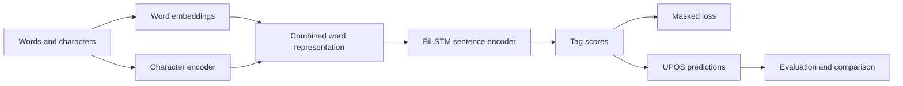
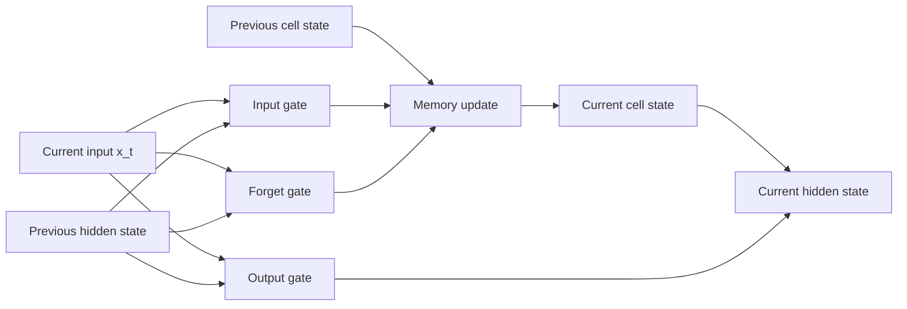
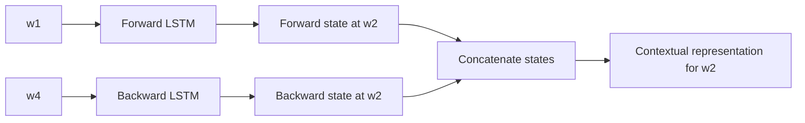
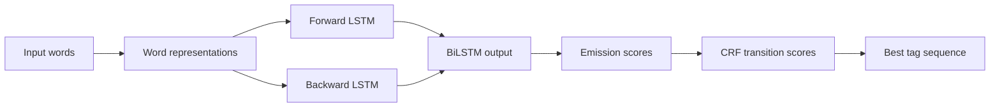
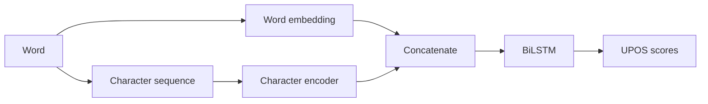
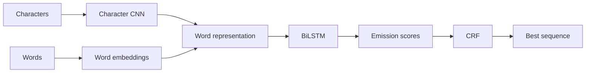
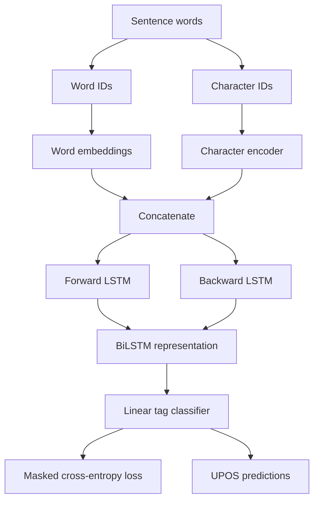
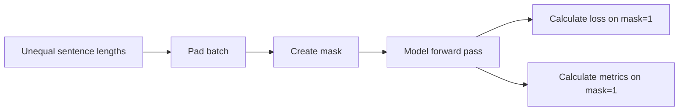
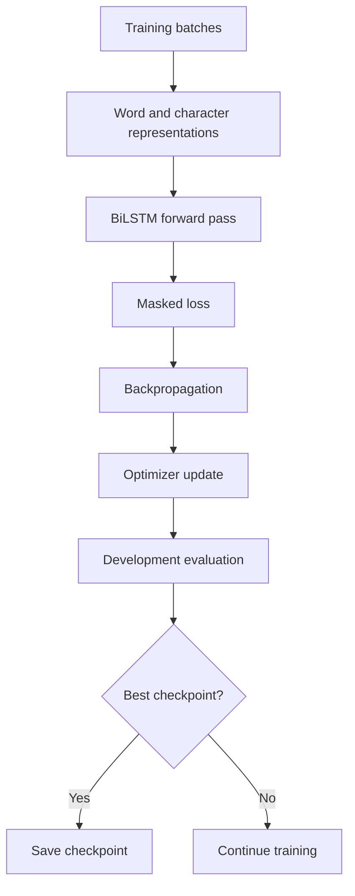
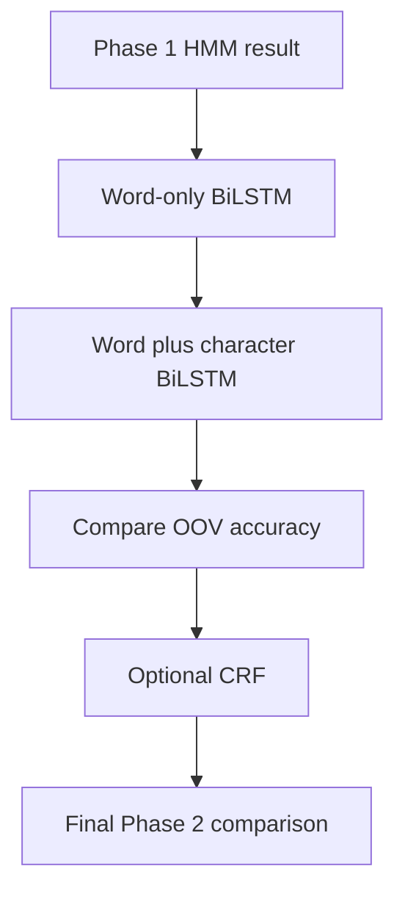

# Phase 2 Paper Implementation Guide

## Purpose

This guide explains how each Phase 2 reference contributes to the neural POS-tagging project.

The Phase 2 objective is:

> Train and evaluate a Bidirectional Long Short-Term Memory (BiLSTM) POS tagger on the official UD English EWT dataset and compare it fairly with the Phase 1 HMM.

The papers do not become separate programs. Each paper supports one part of the same neural sequence-tagging system.



## Required and Optional Work

The required Phase 2 model is:

```text
Word embeddings
+ character or subword features
+ BiLSTM encoder
+ token-level tag classifier
+ masked loss
```

The following is optional:

```text
BiLSTM encoder + CRF decoder
```

Start with a word-only BiLSTM baseline. Then add character features. Add a CRF only after the simpler models work.

## How to Read This Guide

Each paper section answers five questions:

1. What problem does the source address?
2. Which section of the source is relevant?
3. What idea does the project use?
4. What will the code do because of this idea?
5. What is outside the scope of the first implementation?

The formulas use project notation. They explain the source ideas in a consistent form. They are not copied quotations.

## Project Data

Phase 2 uses the same official data as Phase 1:

| Split | Sentences | Tokens |
| --- | ---: | ---: |
| Train | 12,544 | 204,578 |
| Dev | 2,001 | 25,148 |
| Test | 2,077 | 25,094 |

The training vocabulary contains 19,674 word types. Development and test contain unseen word types. The neural model must therefore support `UNK` words and character or subword features.

---

# 1. Hochreiter and Schmidhuber (1997)

## Source

**Paper:** *Long Short-Term Memory*

**Relevant sections:**

- Section 1, **Introduction**
- Section 2, **The Problem of Long-Term Dependencies**
- Section 3, **Long Short-Term Memory**
- Section 4, **Experiments**
- Section 5, **Discussion**
- Section 6, **Conclusion**

The local PDF has damaged text encoding. The section-level locations are more reliable than extracted text.

## What the Paper Does

The paper explains why ordinary recurrent neural networks can have difficulty learning information over long sequences.

During repeated processing, gradients can become:

- too small;
- too large;
- unable to preserve useful information for many time steps.

The LSTM addresses this problem with a memory cell and gates.

## Main LSTM Objects

| Object | Meaning |
|---|---|
| $x_t$ | Input at position $t$. |
| $h_t$ | Hidden output at position $t$. |
| $c_t$ | Internal memory state at position $t$. |
| $i_t$ | Input gate. |
| $f_t$ | Forget gate. |
| $o_t$ | Output gate. |
| $\tilde{c}_t$ | Candidate memory content. |

## LSTM Flow



## LSTM Equations

Input gate:

$$
 i_t = \sigma(W_i x_t + U_i h_{t-1} + b_i)
$$

Forget gate:

$$
 f_t = \sigma(W_f x_t + U_f h_{t-1} + b_f)
$$

Output gate:

$$
 o_t = \sigma(W_o x_t + U_o h_{t-1} + b_o)
$$

Candidate cell content:

$$
 \tilde{c}_t = \tanh(W_c x_t + U_c h_{t-1} + b_c)
$$

Cell update:

$$
 c_t = f_t \odot c_{t-1} + i_t \odot \tilde{c}_t
$$

Hidden output:

$$
 h_t = o_t \odot \tanh(c_t)
$$

Here:

- $\sigma$ is the sigmoid function;
- $\tanh$ is the hyperbolic tangent function;
- $\odot$ is element-wise multiplication.

## What the Project Uses

The project uses the LSTM cell as the basic recurrent unit inside the BiLSTM.

The LSTM can preserve useful information from earlier words. This is useful when a POS decision depends on context that is farther away than one neighboring word.

Example:

```text
The old train station ...
```

The word `train` can be a noun or a verb. Wider sentence context can help the model make the decision.

## Code Responsibility

The neural model must contain a recurrent layer that maintains:

- hidden state;
- cell state;
- input gate;
- forget gate;
- output gate.

A framework implementation such as PyTorch's `LSTM` or `LSTM`-based module may be used. The paper explains the logic; the framework performs the tensor operations.

## What Is Not Required

The project does not need to reproduce the original memory-copying experiments. It needs to use the LSTM as a sequence encoder for POS tagging.

---

# 2. Graves and Schmidhuber (2005)

## Source

**Paper:** *Framewise Phoneme Classification with Bidirectional LSTM and Other Neural Network Architectures*

**Relevant sections:**

- Section I, **Introduction**
- Section II, **Bidirectional Recurrent Neural Nets**
- Section III, **LSTM**
- Section IV, **Experimental Data**
- Section V, **Network Architectures**
- Section VI, **Network Training**
- Section VII, **Results**
- Section VIII, **Conclusion and Future Work**

## What the Paper Does

The paper explains bidirectional recurrent networks.

A normal recurrent network processes a sequence in one direction:

```text
word_1 -> word_2 -> word_3 -> word_4
```

A backward recurrent network processes it in the other direction:

```text
word_4 -> word_3 -> word_2 -> word_1
```

A BiLSTM combines both directions at every position.

## Why Both Directions Matter

For POS tagging, the correct tag can depend on words before and after the current word.

Example:

```text
They record music.
The record is old.
```

The word `record` can be a verb or a noun. Both left and right context can help.

## Bidirectional Structure



For every position $t$:

$$
\overrightarrow{h_t} = LSTM_{forward}(x_t, \overrightarrow{h}_{t-1})
$$

$$
\overleftarrow{h_t} = LSTM_{backward}(x_t, \overleftarrow{h}_{t+1})
$$

Combine them:

$$
 h_t^{bi} =
[\overrightarrow{h_t};\overleftarrow{h_t}]
$$

The square brackets mean concatenation.

## What the Project Uses

The project uses a BiLSTM as the sentence encoder.

For each word, the encoder produces a representation that contains:

- information from the left context;
- information from the current word;
- information from the right context.

## Code Responsibility

The model must:

1. receive a batch of word representations;
2. process the sequence forward;
3. process the sequence backward;
4. concatenate both outputs;
5. send the combined output to a tag classifier.

## What Is Not Required

The project does not need to reproduce phoneme classification. The paper provides the bidirectional architecture and training idea, not the project dataset.

---

# 3. Huang, Xu, and Yu (2015)

## Source

**Paper:** *Bidirectional LSTM-CRF Models for Sequence Tagging*

**Relevant sections:**

- Section 1, **Introduction**
- Section 2, **Models**
- Section 2.1, **LSTM Networks**
- Section 2.2, **Bidirectional LSTM Networks**
- Section 2.3, **CRF Networks**
- Section 2.4, **LSTM-CRF Networks**
- Section 2.5, **BI-LSTM-CRF Networks**
- Section 3, **Training Procedure**
- Section 4, **Experiments**
- Section 5, **Discussions**
- Section 6, **Conclusions**

## What the Paper Does

The paper combines two ideas:

1. A BiLSTM creates contextual representations.
2. A CRF scores the complete output sequence.

The BiLSTM answers:

> What does this token mean in its sentence context?

The CRF answers:

> How likely is this complete sequence of tags?

## Model Structure



## What the Project Uses

The paper helps compare these possible models:

```text
BiLSTM + token softmax
BiLSTM + CRF
```

The first model should be implemented first.

The CRF should be an optional experiment after the token-softmax model works.

## Code Responsibility

The project should measure whether the CRF improves the same BiLSTM encoder.

Keep these parts fixed when comparing:

- dataset;
- word vocabulary;
- character features;
- hidden dimension;
- training split;
- development split;
- test split;
- evaluation metrics.

Only the output layer should change in the first CRF comparison.

## What Is Not Required Initially

Do not begin with BiLSTM-CRF. It adds:

- transition parameters;
- a partition function;
- sequence-level decoding;
- more complex masking rules.

First establish a correct BiLSTM with token-level cross-entropy loss.

---

# 4. Lample et al. (2016)

## Source

**Paper:** *Neural Architectures for Named Entity Recognition*

**Relevant sections:**

- Section 1, **Introduction**
- Section 2.1, **LSTM**
- Section 2.2, **CRF Tagging Models**
- Section 2.3, **Parameterization and Training**
- Section 4, **Input Word Embeddings**
- Section 4.1, **Character-based Models of Words**
- Section 4.2, **Pretrained Embeddings**
- Section 4.3, **Dropout Training**
- Section 5, **Experiments**

## What the Paper Does

The paper explains how to represent words using both:

- word-level information;
- character-level information.

This is useful for rare and unseen words.

A word embedding stores a learned vector for a word. A character encoder creates a vector from the spelling of the word.

## Word Representation

For word $w_t$:

$$
 e_t^{word} = E_{word}[id(w_t)]
$$

If the word is known, its word ID selects a learned vector.

If the word is unknown, the model uses the `<UNK>` word vector.

## Character Representation

Suppose a word contains characters:

```text
m o d e r n i z e d
```

A character encoder processes those characters and creates:

$$
 e_t^{char} = CharacterEncoder(c_{t,1}, \ldots, c_{t,M})
$$

The final word representation is:

$$
 e_t = [e_t^{word}; e_t^{char}]
$$

## Architecture



## What the Project Uses

The project uses character features because the EWT development and test sets contain unseen word types.

Character features can learn patterns such as:

- `-ing` endings;
- `-ly` endings;
- capitalization;
- punctuation patterns;
- common inflectional forms.

## Code Responsibility

The preprocessing code must create:

- word vocabulary from training words;
- character vocabulary from training characters;
- `<UNK>` word ID;
- `<UNK_CHAR>` character ID;
- padding IDs.

The model must produce one combined vector per word.

## What Is Not Required Initially

Pretrained embeddings are optional. The first model can use trainable randomly initialized embeddings.

If pretrained embeddings are used later, record:

- source;
- dimension;
- vocabulary;
- whether they are frozen;
- whether they are fine-tuned.

---

# 5. Ma and Hovy (2016)

## Source

**Paper:** *End-to-End Sequence Labeling via Bi-directional LSTM-CNNs-CRF*

**Relevant sections:**

- Section 1, **Introduction**
- Section 2, **Neural Network Architecture**
- Section 2.1, **CNN for Character-level Representation**
- Section 2.2, **Bi-directional LSTM**
- Section 2.2.1, **LSTM Unit**
- Section 2.2.2, **BLSTM**
- Section 2.3, **CRF**
- Section 2.4, **BLSTM-CNNs-CRF**
- Section 3, **Network Training**
- Section 3.1, **Parameter Initialization**
- Section 3.2, **Optimization Algorithm**
- Section 3.3, **Tuning Hyper-Parameters**
- Section 4.6, **OOV Error Analysis**

## What the Paper Does

The paper combines three components:

1. Character CNN for word representation.
2. BiLSTM for sentence context.
3. CRF for sequence-level output decisions.



## Character CNN

A convolution filter examines character windows.

For a character sequence $x$ and filter width $k$:

$$
 z_j =
\phi(Wx_{j:j+k-1}+b)
$$

The model applies max pooling:

$$
 e^{char}[r] = \max_j z_j[r]
$$

This produces a fixed-size character representation even when words have different lengths.

## What the Project Uses

The project can use either:

- character CNN;
- character BiLSTM.

The required idea is the same:

> Build a representation from the characters of the word so that rare and unseen words have useful features.

The first implementation should choose one method. Do not implement both before the basic model is tested.

## Training Guidance

The paper discusses:

- parameter initialization;
- optimization;
- hyperparameter tuning;
- dropout;
- OOV analysis.

The project will use these ideas to record:

- hidden dimension;
- embedding dimension;
- learning rate;
- batch size;
- dropout rate;
- maximum epochs;
- checkpoint selection rule.

## OOV Error Analysis

The paper supports a separate analysis for out-of-vocabulary words.

The project must compare:

```text
Word-only BiLSTM on unknown words
Word + character BiLSTM on unknown words
```

The unknown-word definition must come from the original training vocabulary.

## What Is Not Required Initially

Do not assume that a CRF is required just because the paper uses one. The project specification requires a BiLSTM tagger with word and character or subword features. A CRF is an optional extension.

---

# 6. Plank, Søgaard, and Goldberg (2016)

## Source

**Paper:** *Multilingual Part-of-Speech Tagging with Bidirectional Long Short-Term Memory Models and Auxiliary Loss*

**Relevant sections:**

- Section 1, **Introduction**
- Section 3.1, **Datasets**
- Section 3.2, **Results**
- Section 4, **Related Work**
- Section 5, **Conclusions**

## What the Paper Does

This is the most directly POS-focused Phase 2 paper in the folder.

It studies BiLSTM POS tagging across multiple languages and examines auxiliary supervision.

The important lessons are:

- BiLSTM models can learn useful contextual POS representations;
- results depend on the language and dataset;
- POS tagging requires careful evaluation;
- additional loss functions are research extensions.

## What the Project Uses

The project uses the paper to justify:

- a BiLSTM POS tagger;
- direct POS-tag prediction;
- comparison on the target EWT dataset;
- careful reporting of results.

## Code Responsibility

The first model should have one task:

```text
Input sentence -> UPOS tag for every token
```

The model should not begin with auxiliary tasks.

## Auxiliary Loss

An auxiliary loss is an additional training objective. A combined loss may look like:

$$
L_{total} = L_{POS} + \lambda L_{auxiliary}
$$

For Phase 2, use:

$$
L_{total} = L_{POS}
$$

until the basic model is stable.

If an auxiliary loss is added later, record:

- what the auxiliary task predicts;
- the value of $\lambda$;
- why the task is relevant;
- whether development performance improves.

## What Is Not Required Initially

Do not implement multilingual training or auxiliary loss in the first BiLSTM. The target is English EWT POS tagging.

---

# 7. Neural Model Used by the Project

The papers combine into this model:



## Combined Input Representation

For each word:

$$
 e_t = [e_t^{word}; e_t^{char}]
$$

The word and character vectors must be concatenated along their feature dimension.

## BiLSTM Output

$$
 h_t^{bi} =
[\overrightarrow{h_t}; \overleftarrow{h_t}]
$$

This output contains both left and right context.

## Tag Scores

For each token:

$$
 z_t = W_y h_t^{bi} + b_y
$$

The score vector has one value for every UPOS tag.

## Token-Level Prediction

$$
P(y_t=c \mid x) =
\frac{\exp(z_{t,c})}
{\sum_{k \in Tags}\exp(z_{t,k})}
$$

The predicted tag is the tag with the highest score.

---

# 8. Padding and Masked Loss

## Why Padding Is Needed

Sentences have different lengths. A batch needs a common sequence length.

Example:

```text
Sentence 1: The dog runs <PAD> <PAD>
Sentence 2: The cat sleeps now here
```

`<PAD>` is not a real word. It must not affect training or evaluation.

## Padding Mask

Define:

$$
 m_{b,t} =
\begin{cases}
1 & \text{if position } t \text{ is a real token}\\
0 & \text{if position } t \text{ is padding}
\end{cases}
$$

## Masked Cross-Entropy

$$
L =
-\frac{1}{\sum_{b,t}m_{b,t}}
\sum_{b,t}m_{b,t}
\log P(y_{b,t}\mid x_b)
$$

The mask must be applied to:

- loss;
- predictions returned to evaluation;
- token accuracy;
- macro F1;
- confusion matrix.

## Code Responsibility

The data loader or batch builder must retain original sentence lengths.

The training code must:

1. create padded word tensors;
2. create padded character tensors;
3. create tag tensors;
4. create a Boolean mask;
5. calculate loss only on real tokens;
6. remove padding before calculating metrics.



## What Is Not Required

Padding must not be treated as an additional POS tag. It is a batch-management symbol only.

---

# 9. Optional CRF Layer

The CRF ideas come mainly from Huang et al., Lample et al., and Ma and Hovy.

## What a CRF Does

A token-level softmax predicts each tag using the BiLSTM output.

A CRF scores the complete tag sequence. It includes:

- emission scores from the BiLSTM;
- transition scores between tags;
- start and end scores.

## CRF Score

Let $s_t(y_t)$ be the emission score at position $t$.

Let $A_{a,b}$ be the transition score from tag $a$ to tag $b$.

The sequence score is:

$$
\begin{aligned}
Score(x,y) ={}&
\sum_{t=1}^{T}s_t(y_t) \\
&+ \sum_{t=1}^{T-1}A_{y_t,y_{t+1}} \\
&+ A_{START,y_1} \\
&+ A_{y_T,END}
\end{aligned}
$$

The conditional probability is:

$$
P(y\mid x) =
\frac{\exp(Score(x,y))}
{\sum_{y'}\exp(Score(x,y'))}
$$

Training minimizes:

$$
L_{CRF} = -\log P(y^{gold}\mid x)
$$

Decoding selects:

$$
\hat{y} =
\underset{y}{\max}\ Score(x,y)
$$

## Implementation Order

Use this order:

```text
1. Word-only BiLSTM + softmax
2. Word and character BiLSTM + softmax
3. Optional BiLSTM + CRF
```

This order makes debugging easier. If the CRF model fails, the project can compare it with the working softmax model.

## What Is Not Required Initially

The CRF is not required for the first Phase 2 model. It should be reported as an optional experiment.

---

# 10. Training and Regularization

## Source Sections

Use:

- Ma and Hovy, Section 3.1, **Parameter Initialization**;
- Ma and Hovy, Section 3.2, **Optimization Algorithm**;
- Ma and Hovy, Section 3.3, **Tuning Hyper-Parameters**;
- Lample et al., Section 4.3, **Dropout Training**;
- Huang et al., Section 3, **Training Procedure**.

## Parameters to Record

The experiment must record:

- word embedding dimension;
- character embedding dimension;
- character encoder type;
- BiLSTM hidden dimension;
- number of BiLSTM layers;
- dropout value;
- learning rate;
- optimizer;
- batch size;
- maximum epochs;
- random seed;
- checkpoint-selection metric.

## Training Flow



## Development Selection

Use the development set to choose:

- learning rate;
- dropout;
- hidden dimension;
- number of epochs;
- word-only versus character model;
- optional CRF;
- best checkpoint.

Do not use the test set for these choices.

## Dropout

Dropout reduces dependence on individual features or hidden units.

Record where dropout is applied:

- word embeddings;
- combined word representation;
- between recurrent layers;
- classifier input.

Dropout must be disabled during evaluation.

---

# 11. Phase 2 Evaluation

Use the same metrics as Phase 1 so the HMM and BiLSTM comparison is fair.

## Token Accuracy

$$
Accuracy =
\frac{correct\ real-token\ predictions}
{all\ real\ evaluation\ tokens}
$$

## Macro F1

$$
F1_{macro} =
\frac{1}{K}\sum_{c=1}^{K}F1_c
$$

## Unknown-Word Accuracy

Let $U$ be the positions whose original words do not appear in the training vocabulary:

$$
UnknownAccuracy =
\frac{correct\ predictions\ on\ U}
{|U|}
$$

## Required Comparison

Compare:

```text
Phase 1 HMM
Word-only BiLSTM
Word + character BiLSTM
Optional BiLSTM-CRF
```

Use the same:

- data splits;
- target UPOS labels;
- unknown-word definition;
- metrics;
- error-analysis method.

---

# 12. OOV and Error Analysis

## Source

Ma and Hovy, Section 4.6, **OOV Error Analysis**.

## Required OOV Records

For every unknown-word prediction, keep:

- original word;
- gold tag;
- predicted tag;
- sentence context;
- model name;
- correct or incorrect status.

## Example

```text
Word: modernized
Known in training: No
Gold tag: VERB
HMM prediction: NOUN
BiLSTM prediction: VERB
Character BiLSTM prediction: VERB
```

This example can show whether character features help with an unseen word.

## Error Groups

Group errors by:

- gold tag;
- predicted tag;
- known or unknown word;
- word frequency;
- sentence length;
- model type.

Ask:

- Does the BiLSTM improve ambiguous words?
- Does the character model improve unknown words?
- Does the CRF improve tag transitions?
- Which rare tags remain difficult?

Do not claim improvement from one example. Use the complete metric table and representative examples.

---

# 13. Final Phase 2 Code Responsibilities

The papers lead to these modules:

```text
src/
├── dataset_loader.py
├── dataset_registry.py
├── preprocessing.py
├── bilstm_model.py
├── crf_layer.py              # optional
└── evaluation.py
```

## `preprocessing.py`

Uses Lample et al. and Ma and Hovy.

Responsibilities:

- build word vocabulary from training data;
- build character vocabulary from training data;
- create `UNK` and `UNK_CHAR` values;
- convert words to IDs;
- convert characters to IDs;
- create tag IDs;
- create padding masks.

## `bilstm_model.py`

Uses Hochreiter and Schmidhuber, Graves and Schmidhuber, Huang et al., and Plank et al.

Responsibilities:

- word embeddings;
- character encoder;
- combined word representation;
- forward LSTM;
- backward LSTM;
- UPOS classifier;
- masked loss.

## `crf_layer.py`

Uses Huang et al., Lample et al., and Ma and Hovy.

Responsibilities:

- transition scores;
- sequence score;
- partition function;
- masked sequence loss;
- Viterbi-style sequence decoding.

This module is optional.

## `evaluation.py`

Uses the Phase 1 evaluation guidance and the OOV discussion from Ma and Hovy.

Responsibilities:

- remove padding;
- calculate accuracy;
- calculate macro F1;
- calculate unknown-word accuracy;
- calculate per-tag metrics;
- create confusion matrices;
- save predictions for error analysis.

---

# 14. Recommended Experiment Order



## Experiment 1: Word-Only BiLSTM

Purpose:

- verify the neural training loop;
- verify the tag classifier;
- verify padding masks;
- create a neural baseline.

## Experiment 2: Word Plus Character BiLSTM

Purpose:

- test subword information;
- improve unknown-word representation;
- compare OOV accuracy with the word-only model.

## Experiment 3: Optional BiLSTM-CRF

Purpose:

- test whether sequence-level tag transitions improve results;
- compare the CRF with the same BiLSTM softmax model.

## Experiment 4: Final Comparison

Report:

| Model | Accuracy | Macro F1 | Unknown accuracy |
|---|---:|---:|---:|
| HMM |  |  |  |
| Word-only BiLSTM |  |  |  |
| Word + character BiLSTM |  |  |  |
| BiLSTM-CRF |  |  |  |

Do not report an optional model as the main result if it was not fully tested.

---

# 15. What the Project Must Not Do

Do not:

- use test data to select hyperparameters;
- build vocabularies from development or test data;
- allow padding to affect the loss;
- allow padding to affect metrics;
- compare models using different test tokens;
- call an unknown word known because it appears in the full dataset vocabulary;
- add a CRF before the softmax baseline works;
- add an auxiliary loss before the single-task model works;
- claim that character features help without OOV results;
- claim that a BiLSTM understands long-range syntax from one score;
- compare a heavily tuned BiLSTM with an untuned HMM without reporting settings;
- copy an architecture without recording its changed assumptions.

---

# 16. Final Paper-to-Implementation Summary

| Source | Implementation responsibility |
|---|---|
| Hochreiter and Schmidhuber | LSTM memory cell and gates. |
| Graves and Schmidhuber | Forward and backward recurrent processing. |
| Huang, Xu, and Yu | BiLSTM and optional CRF comparison. |
| Lample et al. | Word and character representations. |
| Ma and Hovy | Character CNN option, CRF design, training, dropout, and OOV analysis. |
| Plank, Søgaard, and Goldberg | POS-specific BiLSTM motivation and optional auxiliary loss. |

The final Phase 2 flow is:

```text
Official EWT data
    -> word and character IDs
    -> word and character representations
    -> BiLSTM context encoder
    -> masked tag loss
    -> UPOS predictions
    -> accuracy, macro F1, and OOV analysis
    -> comparison with Phase 1 HMM
```

This is the role of every Phase 2 paper in the project.
