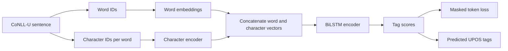
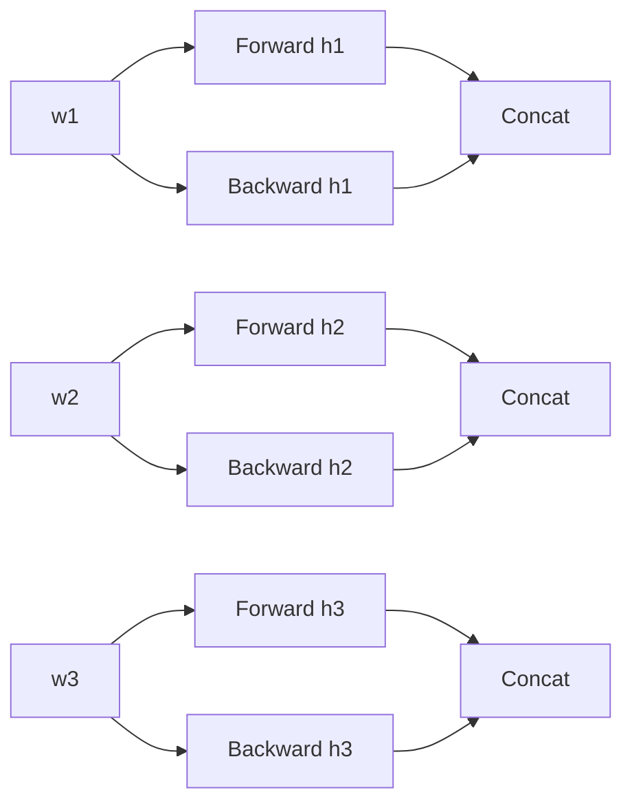
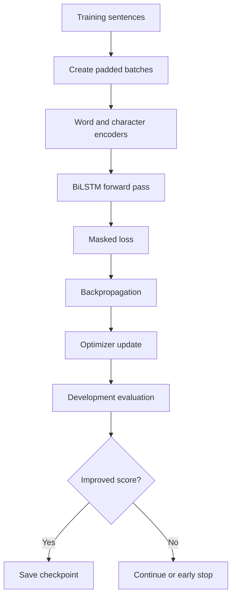

# Phase 2 Literature Guide: BiLSTM POS Tagging

## Purpose

This document converts the Phase 2 references into an implementation guide for the project:

> Train and evaluate a Bidirectional Long Short-Term Memory (BiLSTM) POS tagger on the official UD English EWT train, development, and test splits, then compare it with the Phase 1 HMM.

The Phase 2 model must use context from both directions. The project specification also requires word and character or subword representations and correct masking for padded batches.

The guide has two levels:

- **Required model:** word representation plus character or subword representation, BiLSTM encoder, token-level tag classifier, and masked loss.
- **Supported extension:** a CRF decoding layer on top of the BiLSTM. Use it only after the required model is stable and tested.

Do not compare an unfinished BiLSTM with a tuned HMM. First define both systems, train them with the same data splits, and report the same metrics.

## Recommended Reading Order

| Order | Local PDF | Main use in this project |
| --- | --- | --- |
| 1 | `HorchreiterSchmidhuber_LSTM.pdf` | Learn the LSTM memory cell and the long-term dependency problem. |
| 2 | `Graves and Schmidhuber (2005), Framewise Phoneme Classification with Bidirectional LSTM.pdf` | Learn bidirectional recurrent processing and sequence-level training. |
| 3 | `Lample et al. (2016), Neural Architectures for Named Entity Recognition.pdf` | Learn word plus character representations and LSTM-CRF tagging. |
| 4 | `Ma and Hovy (2016), End-to-End Sequence Labeling via Bi-directional LSTM-CNNs-CRF.pdf` | Learn character CNNs, BiLSTM, CRF scoring, dropout, and OOV analysis. |
| 5 | `Huang, Z., Xu, W., & Yu, K. (2015)..pdf` | Compare LSTM, BiLSTM, CRF, and BiLSTM-CRF models. |
| 6 | `Plank, Søgaard, and Goldberg (2016), Multilingual Part-of-Speech Tagging with Bidirectional LSTM Models and Auxiliary Loss.pdf` | Read the POS-specific motivation, multilingual setting, and auxiliary-loss idea. |

The most important papers for this project are Hochreiter and Schmidhuber, Graves and Schmidhuber, Lample et al., Ma and Hovy, and Plank et al.

## How to Use the Source Notes

Each source note gives the local PDF and the section title from which the idea is taken. Equations in this guide are rewritten in project notation. They explain the same mechanism but are not copied as a replacement for the original paper.

| Topic | Source location | Project use |
| --- | --- | --- |
| LSTM memory and gates | `HorchreiterSchmidhuber_LSTM.pdf`, Section 3, **Long Short-Term Memory**, including the Constant Error Carousel and LSTM architecture subsections | Implement the cell state and gates. |
| Bidirectional recurrence | `Graves and Schmidhuber (2005), Framewise Phoneme Classification with Bidirectional LSTM.pdf`, Section II, **Bidirectional Recurrent Neural Nets**, and Section III, **LSTM** | Use left and right context at every token. |
| Word and character representations | `Lample et al. (2016), Neural Architectures for Named Entity Recognition.pdf`, Section 4.1, **Character-based models of words**, and `Ma and Hovy (2016), End-to-End Sequence Labeling via Bi-directional LSTM-CNNs-CRF.pdf`, Section 2.1, **CNN for Character-level Representation** | Build a representation for rare and unseen words. |
| BiLSTM sequence encoder | `Ma and Hovy (2016), End-to-End Sequence Labeling via Bi-directional LSTM-CNNs-CRF.pdf`, Section 2.2, **Bi-directional LSTM** | Encode the sentence in both directions. |
| Token classifier | `Lample et al. (2016), Neural Architectures for Named Entity Recognition.pdf`, Sections 2.1-2.3 | Produce tag scores and train the sequence model. |
| CRF decoder | `Huang, Z., Xu, W., & Yu, K. (2015)..pdf`, Sections 2.3-2.5; `Ma and Hovy (2016)...pdf`, Section 2.3, **CRF** | Add structured tag-transition scores as an optional extension. |
| Training and regularization | `Ma and Hovy (2016)...pdf`, Sections 3.1-3.3; `Lample et al. (2016)...pdf`, Sections 4.3 and 5.1 | Initialize, optimize, tune, and regularize the model. |
| POS-specific design | `Plank, Søgaard, and Goldberg (2016)...pdf`, Sections 1, 3.1, and 3.2 | Connect BiLSTM design to POS tagging. |
| OOV evaluation | `Ma and Hovy (2016)...pdf`, Section 4.6, **OOV Error Analysis** | Measure unknown-word performance separately. |

## 1. Project Context

The Phase 2 model uses the same data as Phase 1:

| Split | Sentences | Tokens |
| --- | ---: | ---: |
| Train | 12,544 | 204,578 |
| Dev | 2,001 | 25,148 |
| Test | 2,077 | 25,094 |

The training vocabulary contains 19,674 word types. The EDA shows unseen word types in development and test. This makes character or subword information important, but it does not remove the need for a training-only word vocabulary.

The target is the official UPOS tag. The model must produce one UPOS tag for each real input token. Padding positions are not tokens and must not affect the loss or the metrics.



### Source anchor

The sequence-labeling framing comes from `HorchreiterSchmidhuber_LSTM.pdf`, Section 3, and `Graves and Schmidhuber (2005)...pdf`, Sections II-III. The word and character input design comes from `Lample et al. (2016)...pdf`, Section 4.1, and `Ma and Hovy (2016)...pdf`, Section 2.1.

## 2. Literature Synthesis

### 2.1 LSTM: Hochreiter and Schmidhuber

**Source anchor:** `HorchreiterSchmidhuber_LSTM.pdf`, Section 2, **The Problem of Long-Term Dependencies**, and Section 3, **Long Short-Term Memory**, including the Constant Error Carousel and LSTM architecture discussion. The local PDF has damaged text encoding, so the section-level locator is more reliable than extracted page text.

The paper explains why ordinary recurrent networks have difficulty learning relationships over long distances. During repeated multiplication through time, gradients can become extremely small or extremely large. The LSTM introduces a memory path with controlled updates.

The key objects are:

- $x_t$: input vector at position $t$;
- $h_t$: exposed hidden state at position $t$;
- $c_t$: internal cell state at position $t$;
- $i_t$: input gate;
- $f_t$: forget gate;
- $o_t$: output gate;
- $\tilde{c}_t$: candidate cell content.

The cell state lets the network preserve useful information and remove information when the gates require it. In POS tagging, this can help a token use context that is farther away than one or two previous tags.

**Project lesson:** the LSTM is not a probability table. It learns vector representations and parameters by minimizing a loss over tagged sentences.

### 2.2 Bidirectional LSTM: Graves and Schmidhuber

**Source anchor:** `Graves and Schmidhuber (2005), Framewise Phoneme Classification with Bidirectional LSTM.pdf`, Section II, **Bidirectional Recurrent Neural Nets**; Section III, **LSTM**; Section V, **Network Architectures**; Section VI, **Network Training**; and Section VII, **Results**.

A forward recurrent network sees the left context. A backward recurrent network sees the right context. A bidirectional model combines both representations for each position.

For POS tagging this is useful because the tag of a word can depend on words before and after it. For example, a word may be ambiguous when viewed alone but clearer when both neighboring contexts are available.

**Project lesson:** the BiLSTM output at position $t$ should contain both a left-to-right state and a right-to-left state. It must not be implemented as two independent predictions with no combined representation.

### 2.3 BiLSTM and CRF: Huang, Xu, and Yu

**Source anchor:** `Huang, Z., Xu, W., & Yu, K. (2015)..pdf`, Section 2, **Models**, especially Sections 2.1, **LSTM Networks**; 2.2, **Bidirectional LSTM Networks**; 2.3, **CRF networks**; 2.4, **LSTM-CRF networks**; and 2.5, **BI-LSTM-CRF networks**. Training is discussed in Section 3, **Training procedure**; features and robustness are discussed in Sections 4.2-4.3.

This paper separates the model into two ideas:

1. BiLSTM representations provide contextual evidence for each token.
2. A CRF provides a sequence-level score that can prefer legal or likely tag transitions.

The paper compares LSTM, BiLSTM, CRF, LSTM-CRF, and BiLSTM-CRF variants. The comparison is useful for understanding what each component contributes.

**Project decision:** implement the BiLSTM with a token-level softmax first. Add a CRF only as a controlled extension. This gives a simple baseline and makes it possible to measure whether the CRF improves the same encoder.

### 2.4 Character and word representations: Lample et al.

**Source anchor:** `Lample et al. (2016), Neural Architectures for Named Entity Recognition.pdf`, Section 2.1, **LSTM**; Section 2.2, **CRF Tagging Models**; Section 2.3, **Parameterization and Training**; Section 4.1, **Character-based models of words**; Section 4.2, **Pretrained embeddings**; and Section 4.3, **Dropout training**.

The paper shows how a word representation can combine a word embedding with a character-based representation. Character information can represent spelling patterns and can produce a useful vector for a word that is not in the word vocabulary.

For this project, the character representation can capture patterns such as:

- suffixes that correlate with POS tags;
- capitalization patterns;
- punctuation shapes;
- inflectional endings;
- rare and unseen word forms.

**Project decision:** start with randomly initialized word embeddings and a trainable character encoder. Pretrained embeddings are optional. If pretrained embeddings are used, record their source, vocabulary, dimension, and whether they are frozen or updated.

### 2.5 Character CNN and BiLSTM-CRF: Ma and Hovy

**Source anchor:** `Ma and Hovy (2016), End-to-End Sequence Labeling via Bi-directional LSTM-CNNs-CRF.pdf`, Section 2, **Neural Network Architecture**, especially Sections 2.1, **CNN for Character-level Representation**; 2.2, **Bi-directional LSTM**; 2.3, **CRF**; and 2.4, **BLSTM-CNNs-CRF**. Training is in Section 3. OOV analysis is in Section 4.6, **OOV Error Analysis**.

This paper uses a character CNN to create a word representation, a BiLSTM to encode sentence context, and a CRF to score the output sequence. It is a useful design reference because each component has a clear role.

The character CNN is not required to use the same architecture as the paper. The project can use a character BiLSTM instead. The important requirement is to state the representation and test it separately from the word-only baseline.

The paper also discusses parameter initialization, optimization, dropout, and OOV error analysis. These sections are useful for the experiment protocol and for explaining why unknown-word results must be reported.

### 2.6 POS tagging: Plank, Søgaard, and Goldberg

**Source anchor:** `Plank, Søgaard, and Goldberg (2016), Multilingual Part-of-Speech Tagging with Bidirectional LSTM Models and Auxiliary Loss.pdf`, Section 1, **Introduction**; Section 3.1, **Datasets**; Section 3.2, **Results**; Section 4, **Related Work**; and Section 5, **Conclusions**.

This is the most directly POS-focused Phase 2 paper in the folder. It studies BiLSTM POS tagging across languages and considers auxiliary supervision. The main project lessons are:

- POS tagging can use contextual neural representations;
- results can vary across languages and datasets;
- a model must be evaluated on the actual target dataset;
- auxiliary objectives are research extensions, not required for a first implementation.

**Project decision:** do not add an auxiliary loss to the first BiLSTM. First establish a single-task POS tagger with a clear loss and reproducible results.

## 3. The BiLSTM Model for This Project

### 3.1 Input representation

For each word $w_t$, create a word embedding:

$$
 e_t^{word} = E_{word}[id(w_t)]
$$

For each word's character sequence $(c_{t,1}, \ldots, c_{t,M_t})$, create a character representation. A character BiLSTM version is:

$$
 h_{t,j}^{char} = BiLSTM_{char}(c_{t,1}, \ldots, c_{t,M_t})_j
$$

Use the final forward and backward character states:

$$
 e_t^{char} = [\overrightarrow{h}_{t,M_t}^{char};\overleftarrow{h}_{t,1}^{char}]
$$

Combine the representations:

$$
 e_t = [e_t^{word}; e_t^{char}]
$$

The square brackets mean concatenation. Do not add vectors with different dimensions.

**Source anchor:** `Lample et al. (2016)...pdf`, Section 4.1; `Ma and Hovy (2016)...pdf`, Section 2.1. The character BiLSTM choice is a project implementation option; Ma and Hovy use a character CNN.

### 3.2 Optional character CNN

If a character CNN is selected, apply a filter of width $k$ to each character window:

$$
 z_{j} = \phi(W_{char} x_{j:j+k-1} + b_{char})
$$

Apply max pooling over positions:

$$
 e^{char}[r] = \max_j z_j[r]
$$

Use several filter widths and concatenate their pooled outputs if the experiment requires multiple character patterns.

**Source anchor:** `Ma and Hovy (2016)...pdf`, Section 2.1, **CNN for Character-level Representation**. Do not claim that a character CNN and character BiLSTM are the same method. They solve the same representation problem with different encoders.

### 3.3 LSTM cell

For an input $x_t$ and previous hidden state $h_{t-1}$ and cell state $c_{t-1}$:

$$
 i_t = \sigma(W_i x_t + U_i h_{t-1} + b_i)
$$

$$
 f_t = \sigma(W_f x_t + U_f h_{t-1} + b_f)
$$

$$
 o_t = \sigma(W_o x_t + U_o h_{t-1} + b_o)
$$

$$
 \tilde{c}_t = \tanh(W_c x_t + U_c h_{t-1} + b_c)
$$

$$
 c_t = f_t \odot c_{t-1} + i_t \odot \tilde{c}_t
$$

$$
 h_t = o_t \odot \tanh(c_t)
$$

Here $\sigma$ is the sigmoid function and $\odot$ is element-wise multiplication.

The forget gate controls retained memory. The input gate controls new content. The output gate controls the exposed hidden state.

**Source anchor:** `HorchreiterSchmidhuber_LSTM.pdf`, Section 3, **Long Short-Term Memory**; `Ma and Hovy (2016)...pdf`, Section 2.2.1, **LSTM Unit**.

### 3.4 Bidirectional encoding

Run one LSTM from left to right and another from right to left:

$$
\overrightarrow{h_t} = LSTM_{forward}(e_t, \overrightarrow{h}_{t-1})
$$

$$
\overleftarrow{h_t} = LSTM_{backward}(e_t, \overleftarrow{h}_{t+1})
$$

Concatenate their outputs:

$$
 h_t^{bi} = [\overrightarrow{h_t}; \overleftarrow{h_t}]
$$

The output dimension is twice the single-direction hidden dimension unless a projection is applied.

**Source anchor:** `Graves and Schmidhuber (2005)...pdf`, Section II, **Bidirectional Recurrent Neural Nets**; `Ma and Hovy (2016)...pdf`, Section 2.2.2, **BLSTM**.



### 3.5 Tag classifier

For a token-level softmax model:

$$
 z_t = W_y h_t^{bi} + b_y
$$

$$
 p(y_t = c \mid x) = \frac{\exp(z_{t,c})}{\sum_{k \in \mathcal{T}} \exp(z_{t,k})}
$$

where $\mathcal{T}$ is the 17-tag UPOS set.

The predicted tag is:

$$
\hat{y}_t = \max_{c \in \mathcal{T}} p(y_t=c \mid x)
$$

This classifier predicts each position using a contextual representation. Unlike the HMM, it does not explicitly multiply transition and emission probabilities.

**Source anchor:** `Lample et al. (2016)...pdf`, Sections 2.1 and 2.3; `Huang, Z., Xu, W., & Yu, K. (2015)...pdf`, Sections 2.1-2.2.

## 4. Padding and Masked Loss

Sentences have different lengths. A batch therefore uses padding:

```text
sentence 1: w1 w2 w3 w4 <PAD> <PAD>
sentence 2: w1 w2 w3 w4 w5    w6
```

Create a binary mask:

$$
 m_{b,t} =
 \begin{cases}
 1 & \text{if position } t \text{ is a real token in sentence } b\\
 0 & \text{if position } t \text{ is padding}
 \end{cases}
$$

For cross-entropy loss:

$$
 L = -\frac{1}{\sum_{b,t} m_{b,t}}
 \sum_{b,t} m_{b,t}\log p(y_{b,t}\mid x_b)
$$

Padding positions must not contribute to the numerator or denominator. In PyTorch, an equivalent implementation can use `CrossEntropyLoss(ignore_index=pad_tag_id)` if the target tensor uses the ignore index consistently.

For a CRF, the mask must be passed to the CRF forward score, partition-function calculation, and decode operation. Do not compute a CRF score over padding positions.

**Source anchor:** the need for sequence-aware training and decoding is discussed in `Huang, Z., Xu, W., & Yu, K. (2015)...pdf`, Section 3, **Training procedure**, and `Ma and Hovy (2016)...pdf`, Section 3, **Network Training**. The mask equation is the project implementation rule required by the project specification.

### Padding invariants

- All tokens before the first padding position are real tokens.
- Padding positions have no gold tag used for loss calculation.
- The model output keeps a stable batch and sequence shape.
- Metrics use the mask or the original sentence lengths.
- Predictions are truncated back to the original sentence length.
- No padding symbol appears in the final tag sequence.

## 5. Optional CRF Output Layer

A CRF models the complete tag sequence instead of treating each token decision as independent.

Let $s_t(c)$ be the emission score for tag $c$ at position $t$. Let $A_{a,b}$ be the learned transition score from tag $a$ to tag $b$. The score of a tag sequence $y$ is:

$$
Score(x,y) =
\sum_{t=1}^{T}s_t(y_t)
+ \sum_{t=1}^{T-1}A_{y_t,y_{t+1}}
+ A_{START,y_1}
+ A_{y_T,END}
$$

The conditional probability is:

$$
P(y\mid x) =
\frac{\exp(Score(x,y))}
{\sum_{y' \in \mathcal{Y}(x)}\exp(Score(x,y'))}
$$

The denominator is the partition function over all valid tag sequences. Dynamic programming computes it without enumerating every sequence.

Training minimizes negative log likelihood:

$$
L_{CRF} = -\log P(y^{gold}\mid x)
$$

Decoding uses the highest-scoring sequence:

$$
\hat{y} = \max_{y \in \mathcal{Y}(x)} Score(x,y)
$$

This decoding is Viterbi-like, but the scores come from neural emissions and learned tag transitions.

**Source anchor:** `Huang, Z., Xu, W., & Yu, K. (2015)...pdf`, Sections 2.3-2.5; `Ma and Hovy (2016)...pdf`, Section 2.3, **CRF**, and Section 2.4, **BLSTM-CNNs-CRF**.

### When to use the CRF

Use a CRF only after the token-softmax BiLSTM passes tests. The CRF is useful when:

- tag transitions contain strong structure;
- a complete sequence decision is required;
- the project can explain the partition function and transition scores;
- the same data, embeddings, and encoder are used for a fair comparison.

Do not use a CRF only because it produces a more complex diagram. Report whether the CRF improves accuracy, macro F1, unknown-word accuracy, and error patterns.

## 6. Training Procedure

### 6.1 Data preparation

1. Load the official CoNLL-U splits with the existing loader.
2. Preserve each sentence as a separate sequence.
3. Build the word vocabulary from training words only.
4. Add `UNK` to the word vocabulary.
5. Build the character vocabulary from training characters only, with `UNK_CHAR` and `PAD_CHAR`.
6. Build the UPOS tag mapping from training tags and verify that all development and test tags are in the mapping.
7. Convert each sentence to word IDs, character IDs, and tag IDs.
8. Pad a batch only at the batch boundary.
9. Keep original sentence lengths or masks.

### 6.2 Parameter initialization

Use a documented initialization method. For a first model:

- initialize word and character embeddings with a small random distribution;
- initialize recurrent parameters with the framework default or a documented method;
- initialize the classifier bias to zero;
- set random seeds for Python, NumPy, and PyTorch;
- record whether deterministic algorithms are enabled.

**Source anchor:** `Ma and Hovy (2016)...pdf`, Section 3.1, **Parameter Initialization**; `Lample et al. (2016)...pdf`, Section 2.3, **Parameterization and Training**.

### 6.3 Optimization

Use a standard optimizer such as Adam for the first implementation. Select learning rate, batch size, dropout, hidden dimension, and number of epochs using the development split.

Train in epochs:



Use early stopping based on a development metric selected before training. Save the best checkpoint, not only the final epoch.

**Source anchor:** `Ma and Hovy (2016)...pdf`, Section 3.2, **Optimization Algorithm**, and Section 3.3, **Tuning Hyper-Parameters**; `Lample et al. (2016)...pdf`, Section 4.3, **Dropout training**.

### 6.4 Dropout

Dropout reduces reliance on one feature or one hidden unit. Apply it only where the model design states it is applied. Record:

- dropout probability;
- whether it is applied to embeddings;
- whether it is applied between recurrent layers;
- whether it is disabled during evaluation.

Do not compare a heavily regularized BiLSTM with an unregularized HMM as if dropout were a property of the model family. It is a training setting.

## 7. Experiments for This Project

### Required baseline sequence

| Experiment | Purpose | Required? |
| --- | --- | --- |
| Word-only BiLSTM with token softmax | Establish the neural baseline. | Yes |
| Word plus character BiLSTM or CNN | Test subword information and OOV handling. | Yes |
| Best BiLSTM checkpoint on test | Produce the Phase 2 result. | Yes |
| BiLSTM-CRF | Test sequence-level decoding. | Optional |
| Pretrained word embeddings | Test external lexical information. | Optional |
| Auxiliary loss | Reproduce the Plank-style extension. | Optional |

Use the same train, development, and test splits as the HMM. Do not change the test set or use test results to choose hyperparameters.

### Fair HMM versus BiLSTM comparison

Keep these conditions fixed:

- same official dataset revision;
- same tokenization and sentence boundaries;
- same UPOS labels;
- same test token set;
- same unknown-word definition;
- same accuracy, macro F1, and unknown-word accuracy formulas;
- same per-tag error-analysis procedure.

The models do not need the same features. The HMM uses count-based transitions and emissions. The BiLSTM uses learned contextual representations. The comparison must state this difference.

### Results table

Record at least:

| Field | HMM | BiLSTM | BiLSTM + character features | Optional BiLSTM-CRF |
| --- | --- | --- | --- | --- |
| Token accuracy |  |  |  |  |
| Macro F1 |  |  |  |  |
| Unknown-word accuracy |  |  |  |  |
| Number of parameters |  |  |  |  |
| Training time |  |  |  |  |
| Inference time |  |  |  |  |
| Best development epoch |  |  |  |  |

Do not report only the best metric. Report enough information to explain the trade-off between accuracy, model size, training cost, and unknown-word behavior.

## 8. Evaluation and Error Analysis

### 8.1 Required metrics

Use the same metrics as Phase 1:

$$
Accuracy =
\frac{\text{number of correct real-token predictions}}
{\text{number of real evaluation tokens}}
$$

$$
F1_{\text{macro}} = \frac{1}{K}\sum_{c=1}^{K}F1_c
$$

$$
UnknownAccuracy =
\frac{\text{number of correct predictions on originally unseen words}}
{\text{number of originally unseen words}}
$$

Padding positions must be excluded from every metric.

### 8.2 OOV analysis

**Source anchor:** `Ma and Hovy (2016)...pdf`, Section 4.6, **OOV Error Analysis**. Use the source as motivation for a separate OOV analysis, but define OOV using this project's training vocabulary.

For each prediction, retain:

- original word;
- whether the word occurs in training;
- gold UPOS;
- predicted UPOS;
- sentence context;
- model confidence if available.

Compare word-only and word-plus-character models on the same OOV positions. A character model should not be called better only because its overall score is higher; show whether it improves unknown words.

### 8.3 Per-tag errors

Create a confusion matrix and per-tag table. Inspect rare UPOS classes separately. Compare HMM and BiLSTM error patterns:

- Does the BiLSTM reduce ambiguity errors?
- Does the character model reduce unknown-word errors?
- Does the CRF reduce invalid or unlikely tag transitions?
- Which tags remain difficult for both models?

Do not claim that the BiLSTM understands grammar from one score. Use examples and per-tag evidence.

### 8.4 Decoded examples

Show a small fixed set of examples:

| Word | Gold | HMM | BiLSTM | Character BiLSTM |
| --- | --- | --- | --- | --- |
| word 1 |  |  |  |  |
| word 2 |  |  |  |  |

Include at least:

- one ambiguous known word;
- one unknown word;
- one punctuation case;
- one sentence where the HMM and BiLSTM disagree.

Select examples using a documented rule, such as the first examples from each error category. Do not select only successful examples.

## 9. What to Implement in the Repository

A practical structure is:

```text
src/
├── dataset_loader.py
├── preprocessing.py
├── hmm_model.py
├── bilstm_model.py
├── crf_layer.py              # optional
└── evaluation.py

experiments/
├── phase1_hmm.py
└── phase2_bilstm.py

notebooks/
├── eda.ipynb
├── phase1_hmm_analysis.ipynb
└── phase2_bilstm_analysis.ipynb

tests/
├── test_dataset_loader.py
├── test_imports.py
├── test_preprocessing.py
├── test_hmm_model.py
├── test_bilstm_model.py
└── test_evaluation.py
```

Minimum model interface:

```python
model.fit(train_loader, dev_loader)
predictions = model.predict(test_loader)
```

A training method should not silently evaluate on the test set. A prediction method should return one tag sequence per original sentence.

### Minimum tests

Test the following before a long training run:

- word vocabulary uses training data only;
- character vocabulary uses training data only;
- unknown words map to `UNK`;
- character unknown symbols map to `UNK_CHAR`;
- padded batches have the expected mask;
- masked loss ignores padding;
- prediction length equals the original sentence length;
- all predictions belong to the UPOS tag set;
- model output has the expected dimensions;
- evaluation ignores padding;
- a one-batch training run decreases or changes the loss;
- a tiny synthetic dataset can be overfit by the model.

The tiny-dataset test is important. If the model cannot overfit a small, deterministic dataset, do not start a full training run.

## 10. Reproducibility Rules

- Use the locked project environment.
- Record Python, PyTorch, NumPy, and scikit-learn versions.
- Record CPU or GPU information.
- Set random seeds.
- Record the dataset revision.
- Build vocabularies from training data only.
- Save the tag mapping and vocabulary with the checkpoint.
- Save the model configuration.
- Save the best development checkpoint.
- Do not tune on the test split.
- Store training and development curves.
- Store final predictions for error analysis.
- Record padding and mask behavior.
- Record whether embeddings are trainable.
- Record the optimizer, learning rate, batch size, hidden dimension, dropout, and epoch limit.

## 11. Phase 2 Limitations

The Phase 2 literature does not prove that every BiLSTM architecture will improve this project. Results depend on:

- dataset size and genre;
- word and character vocabulary choices;
- initialization;
- regularization;
- hyperparameters;
- unknown-word distribution;
- tag distribution;
- checkpoint selection.

The HMM and BiLSTM also use different assumptions:

| Property | HMM | BiLSTM |
| --- | --- | --- |
| Main representation | Count-based probabilities | Learned vectors |
| Context | Fixed Markov order | Learned sequence context in both directions |
| Unknown words | `UNK` or suffix probabilities | `UNK` word vector plus character/subword features |
| Decoder | Viterbi | Token softmax or optional CRF |
| Training | Count estimation | Gradient-based optimization |
| Interpretability | Direct probability tables | Hidden representations and learned scores |
| Main limitation | Restricted context and sparse counts | More parameters, tuning, and computation |

Use this table in the report only after the implementation and experiments support the statements.

## 12. Phase 2 Deliverables

A complete Phase 2 submission should contain:

1. A neural sequence-tagging literature review.
2. A clear explanation of the LSTM and BiLSTM.
3. A word-only BiLSTM baseline.
4. A word-plus-character or word-plus-subword BiLSTM.
5. Correct padding and masked loss handling.
6. A documented training and checkpoint-selection procedure.
7. Development-set tuning results.
8. Final test-set token accuracy.
9. Final test-set macro F1-score.
10. Unknown-word accuracy.
11. Per-tag metrics and error analysis.
12. Decoded sentence examples.
13. A comparison with the Phase 1 HMM.
14. Optional CRF results, if implemented.
15. Reproducible commands and environment details.
16. A report, presentation, and individual viva preparation.

## 13. Final Phase 2 Checklist

- [ ] The LSTM gates and cell state are understood.
- [ ] The forward and backward LSTM directions are understood.
- [ ] The word-only BiLSTM baseline runs.
- [ ] Character or subword features are implemented.
- [ ] The character vocabulary uses training data only.
- [ ] `UNK` and `UNK_CHAR` handling is documented.
- [ ] Padded positions are masked in the loss.
- [ ] Padded positions are excluded from metrics.
- [ ] The model returns one prediction per real token.
- [ ] A tiny dataset can be overfit as a sanity check.
- [ ] Development data selects hyperparameters and checkpoints.
- [ ] Test data is used only for final reporting.
- [ ] Accuracy, macro F1, and unknown-word accuracy are reported.
- [ ] Per-tag errors and decoded examples are included.
- [ ] The HMM comparison uses the same data and metric definitions.
- [ ] The model configuration and random seed are recorded.
- [ ] The final checkpoint and predictions are preserved.
- [ ] The report, presentation, and viva notes are complete.

## References

- Graves, A., and Schmidhuber, J. (2005). *Framewise Phoneme Classification with Bidirectional LSTM and Other Neural Network Architectures*. Neural Networks, 18(5-6), 602-610.
- Hochreiter, S., and Schmidhuber, J. (1997). *Long Short-Term Memory*. Neural Computation, 9(8), 1735-1780.
- Huang, Z., Xu, W., and Yu, K. (2015). *Bidirectional LSTM-CRF Models for Sequence Tagging*.
- Lample, G., Ballesteros, M., Subramanian, S., Kawakami, K., and Dyer, C. (2016). *Neural Architectures for Named Entity Recognition*. Proceedings of NAACL-HLT 2016.
- Ma, X., and Hovy, E. (2016). *End-to-End Sequence Labeling via Bi-directional LSTM-CNNs-CRF*. Proceedings of ACL 2016.
- Plank, B., Søgaard, A., and Goldberg, Y. (2016). *Multilingual Part-of-Speech Tagging with Bidirectional Long Short-Term Memory Models and Auxiliary Loss*. Proceedings of ACL 2016.
